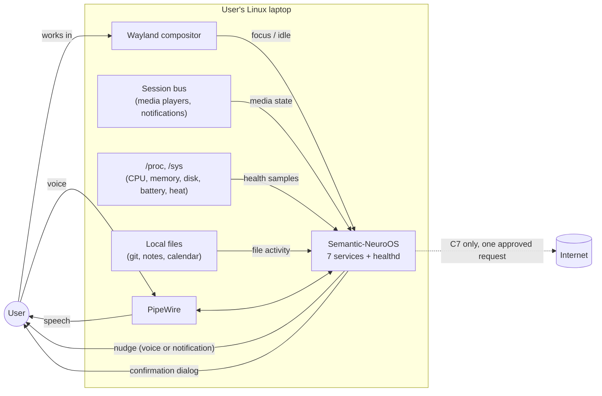
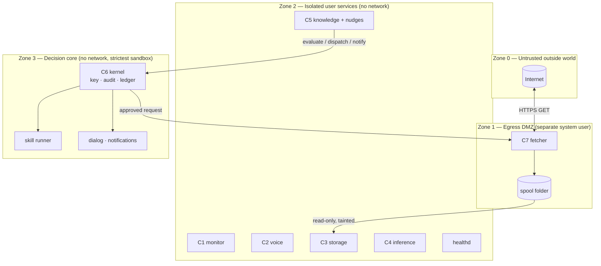
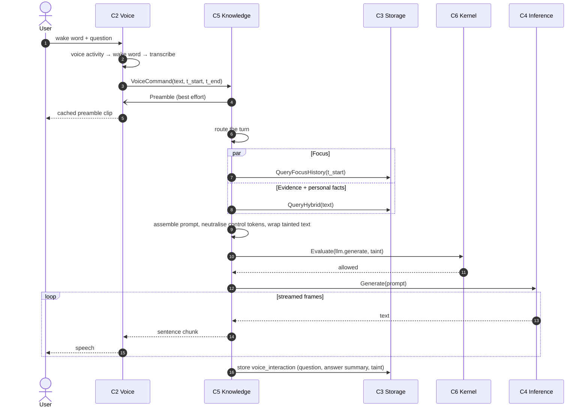
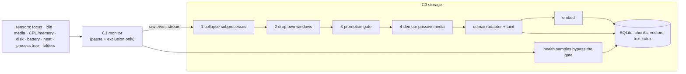
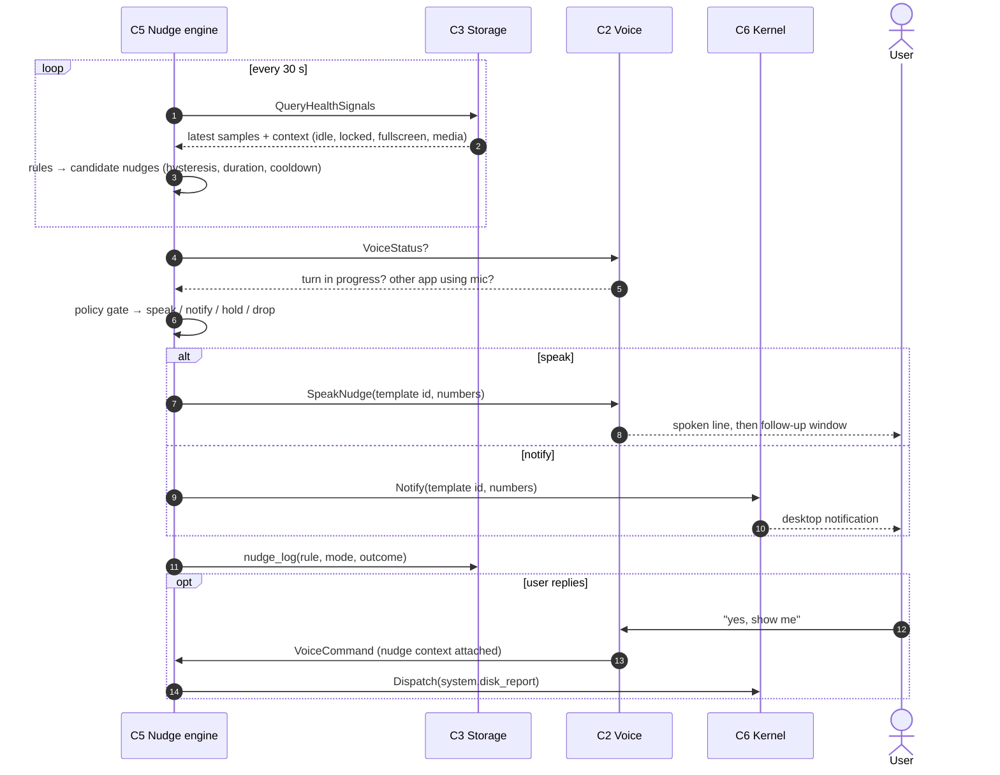

# Architecture — Semantic-NeuroOS

**Document type:** System Architecture Specification
**Document version:** 2.0 · **Date:** 2026-11-14 · **Status:** Baseline for the rebuild
**Implements:** [PRD.md](PRD.md) · **Secured by:** [security.md](security.md) · **Governed by:** [rules.md](rules.md) · **Delivered through:** [phases.md](phases.md)

> Numbers (budgets, targets, limits) live only in [PRD.md](PRD.md) §6. This document refers to them by ID.

---

## 1. Architectural Principles

| # | Principle | What it means in practice |
| :--- | :--- | :--- |
| AP-1 | **No egress by construction** | Isolation is enforced by the kernel (network namespaces, mount namespaces, Landlock), not by code discipline. Only C7 has a network. |
| AP-2 | **Separate processes, contract first** | Seven services and a health daemon share nothing except versioned protobuf contracts. Each can be built, tested and restarted alone. |
| AP-3 | **One owner per resource** | C3 owns all persistent data and the embedding model. C4 owns the language model. C6 owns the HMAC key, the audit log, the egress ledger and every visual surface. |
| AP-4 | **Least privilege, enforced twice** | systemd decides what each unit can see; each process then restricts itself again with Landlock. |
| AP-5 | **Taint only grows** | Web-derived data keeps its flag through every merge. Tiers only rise. |
| AP-6 | **The model proposes, never decides** | Model output is text. Actions happen only through a grammar-limited skill call that C6 evaluates. Nudges and notifications are never model-written. |
| AP-7 | **Simple before clever** | One database. Ordinary sockets. Two languages. Add machinery only when a measurement demands it. |
| AP-8 | **Latency is budgeted** | Every hop has a number; slow work never sits on the answer path. |
| AP-9 | **Degrade, don't die** | Losing a part removes a feature, never the system. |
| AP-10 | **Observable from outside** | Health is scraped by an independent daemon, and each part reports its real state. |

---

## 2. System Context



---

## 3. Component Catalogue

| ID | Service | Language | Runs as | Network | Owns |
| :--- | :--- | :--- | :--- | :--- | :--- |
| C1 | `neuroos-monitor` | Rust | user | none | Sensors only; nothing at rest |
| C2 | `neuroos-voice` | C++20 | user | none | Microphone, speaker, speech-to-text, the one voice |
| C3 | `neuroos-storage` | Rust | user | none | **All persistent user data**, embedding model |
| C4 | `neuroos-inference` | C++20 | user | none | Language model, prompt cache |
| C5 | `neuroos-knowledge` | Rust | user | none | Turn routing, prompt assembly, session history, **nudge engine** |
| C6 | `neuroos-kernel` (+ `neuroos-confirm`, skill runner) | Rust, GTK4 | user | none | Skill registry, HMAC key, audit log, egress ledger, dialog, notifications |
| C7 | `neuroos-fetcher` | Rust | **`neuroos-fetcher`** system user | **egress** | Spool folder |
| D | `neuroos-healthd` | Rust | user | none | Health aggregate, soak baseline |
| — | `neuroosctl` | Rust CLI | user, interactive | none | Nothing |

Budgets: PRD §6.2. Latency targets: PRD §6.1.

---

## 4. Trust Zones



**Boundary rules**

1. Zone 1 → Zone 2: data crosses only through the spool, only as tainted files.
2. Zone 2 → Zone 1: requests come only from C6, only with a valid approval for exactly that request.
3. Zone 3 is the only place a skill runs and the only place anything is shown on screen. C5 proposes; C6 decides.
4. Zones 2 and 3 share the user's UID. Their separation rests on per-unit mount namespaces (§5.2), Landlock (§8.2), `NoNewPrivileges` and ptrace restrictions — see [security.md](security.md) §5 for the limits of this.

---

## 5. IPC Fabric

### 5.1 Transport

- **Unix domain sockets on filesystem paths.** Abstract sockets and loopback TCP/UDP are forbidden.
- **Framing:** 4-byte little-endian length + protobuf `Envelope`. Maximum frame 1 MiB by default, lower on control sockets.
- **Streaming:** a response may be several frames with the same `request_id`; the last carries `end_of_stream = true`. Every stream ends explicitly, also on cancel and error. This carries generated text; there is no shared memory.
- **Deadlines:** every request has one (PRD §6.1).
- **Reconnect:** clients retry with jittered exponential backoff and report DEGRADED meanwhile.
- **Servers survive bad connections:** a failed accept or a malformed frame costs that connection only.

### 5.2 Socket map — enforced, not advisory

Runtime root: `$XDG_RUNTIME_DIR/neuroos/` (mode 0700). **Every socket has its own folder**, `<part>/<name>/<name>.sock` (ADR-0009), so binding a folder into a client exposes exactly one socket. The folders are created before any part starts by `neuroos-runtime.service`. The map below is code (`neuroos-common::socketmap`); the unit files, the peer policies and the security probe are generated from it. Each unit sees an empty runtime root with only the sub-folders of the peers it may call bound in (`TemporaryFileSystem=` + `BindPaths=`). A part cannot open a socket it cannot see. Servers also check the peer's UID (`SO_PEERCRED`) and the peer's systemd unit; a server that checks units needs read access to `/proc/<pid>/cgroup` in its Landlock rules (§8.2, S-04).

| Socket | Server | May connect |
| :--- | :--- | :--- |
| `monitor/stream/stream.sock` | C1 | C3 |
| `monitor/control/control.sock` | C1 | C6, `neuroosctl` |
| `voice/voice/voice.sock` | C2 | C5 |
| `voice/control/control.sock` | C2 | C6, `neuroosctl`, OctoPit (status, start/stop/cancel listening) |
| `storage/storage/storage.sock` | C3 | C5, C6, `neuroosctl` |
| `inference/inference/inference.sock` | C4 | C5 |
| `knowledge/knowledge/knowledge.sock` | C5 | C2, `neuroosctl`, OctoPit (typed questions) |
| `kernel/kernel/kernel.sock` | C6 | C5, `neuroosctl`, OctoPit (read the audit and egress records) |
| `healthd/healthd/healthd.sock` | healthd | `neuroosctl`, OctoPit |
| `<part>/health/health.sock` | every part | healthd |
| `/run/neuroos-fetcher/fetch/fetch.sock` | C7 | C6 only (group `neuroos`, 0660) |
| `/run/neuroos-fetcher/health/health.sock` | C7 | healthd |

OctoPit (`neuroos-octopit`, ADR-0017) is a second user-run client, the desktop dashboard. It is listed as `Client::OctoPit` in the socket map on exactly the four sockets above, never on a health socket, and it has no approval control. `neuroosctl` and OctoPit are ordinary user programs, so anything they can do, any program run by the user can do. Therefore every destructive or outward operation reachable from it goes through C6 and the dialog.

### 5.3 Envelope (`proto/neuroos/v1/envelope.proto`)

```protobuf
syntax = "proto3";
package neuroos.v1;

message Envelope {
  uint32 schema_version = 1;
  string trace_id       = 2;   // carried end to end
  uint64 request_id     = 3;   // 0 for push events
  uint64 sent_at_ns     = 4;   // UTC epoch nanoseconds
  bool   end_of_stream  = 5;   // last frame of a streamed response
  oneof body { /* one field range per component */ }
}

message Error {
  ErrorCode code      = 1;
  string    message   = 2;   // never contains user content
  bool      retryable = 3;
}
```

Field ranges: 10–19 common · 20–39 C1 · 40–59 C2 · 60–99 C3 · 100–119 C4 · 120–159 C5 · 160–199 C6 · 200–219 C7 · 220–239 healthd. Ranges are sized so none runs out.

### 5.4 Versioning

- `neuroos.v1` accepts additive changes only after Phase 1.
- Removing, renumbering or changing meaning needs `neuroos.v2` and an ADR.
- Every contract change has a round-trip test across Rust and C++.

---

## 6. Core Data Flows

### 6.1 Voice question



The typed path (`neuroosctl ask`) is identical from step 3, without C2.

### 6.2 Ingest



**Inside C1 (Phase 3, ADR-0011).** Each sensor is its own supervised task: a failure marks only that sensor DEGRADED (fixed-text detail, one health row per sensor in `neuroosctl status`) and restarts it after jittered backoff. Sensors publish to a bus through one gate — pause and the exclusion list, the only things that may stop or change an event (AB-5). An excluded window becomes a redacted focus event (empty app, title and pid) so the previous span still ends; a pause emits nothing at all and is followed by a snapshot of the current state. Each subscriber (C3's stream, the recorder) has a bounded queue that drops its oldest events and counts the loss; a reader that falls too far behind is cut loose by the IPC layer with a retryable error, and a new subscription starts from the latest state of each kind, so a reconnecting C3 is never blind. Blocking sources (Wayland, `/proc`, inotify) run on their own thread or the blocking pool. Window ids are C1's own and never reused; a lost compositor closes every open window before the sensor reconnects. `neuroos-monitor --record <file>` writes an anonymised dump (format in `neuroos-proto::dump`); `neuroosctl replay` prints it or serves it as a live stream for the Phase 4 harness.

Machine-health samples (CPU, memory, disk, battery, heat) are numeric time series. They skip the promotion gate and embedding and go to the `health_samples` table.

### 6.3 Nudge



The engine itself never calls `Dispatch`. Step 14 happens only because the user spoke.

### 6.4 Web search and taint

```mermaid
sequenceDiagram
    autonumber
    actor U as User
    participant C5 as C5 Knowledge
    participant C6 as C6 Kernel
    participant C7 as C7 Fetcher
    participant SP as Spool
    participant C3 as C3 Storage

    U->>C5: "yes, look it up"
    C5->>C6: Dispatch(web.search, drafted query)
    C6->>U: dialog: editable query, provider, "reads up to N pages"
    U->>C6: Allow once (possibly after editing)
    C6->>C6: bind final args with HMAC, write ATTEMPT
    C6->>C7: SearchRequest(query, N, token)
    C7->>C7: verify token; resolve once; validate address; pin
    C7->>C7: GET search; validate and GET up to N result pages
    C7->>SP: write results (tainted)
    C7-->>C6: hosts, bytes out, bytes in
    C6->>C6: egress ledger entry, RESULT
    SP-->>C3: new files
    C3->>C3: ingest as external_documents, taint set
    C6-->>C5: done (document ids)
    C5->>C3: evidence (tainted)
    C5->>C5: answer; context now tainted → later SAFE skills need approval
```

### 6.5 Barge-in

1. C2 is speaking. Voice activity is detected for two consecutive frames.
2. C2 flushes its output (NFR-PERF-08) and stops its speech worker. This is local and needs no other part.
3. C2 sends `BargeIn` to C5. C5 cancels the generation at C4 and records the turn as interrupted, not delivered.
4. C2 enters the follow-up window, keeping the audio from the start of the interruption.

### 6.6 Health

healthd connects to each `health.sock` every 30 s and reads status, RSS, uptime, latency histograms and error counters; it reads each unit's cgroup files; it keeps a rolling window in memory and, in soak mode, a CSV.

---

## 7. Data Architecture

### 7.1 Filesystem layout

```
/opt/neuroos/
├── bin/
└── models/                      # read-only; manifest.toml holds every sha256

~/.config/neuroos/
├── config.toml                  # one file, one section per part
├── nudges.toml                  # nudge rules (FR-NUD-02)
└── hmac.key                     # 0600; visible only inside C6's unit

~/.local/share/neuroos/          # ALL persistent user data
├── storage/neuroos.sqlite3 (+ -wal)
├── backups/<UTC timestamp>/
├── audit/                       # C6 only (ADR-0010)
│   ├── actions.jsonl (+ rotations)  # audit log, hash-chained
│   └── egress.jsonl  (+ rotations)  # everything sent to the network, hash-chained
└── soak/

/var/spool/neuroos-fetcher/      # 2770 neuroos-fetcher:neuroos
$XDG_RUNTIME_DIR/neuroos/<part>/ # sockets, one folder per server
/run/neuroos-fetcher/            # fetcher sockets
```

### 7.2 Storage model — one SQLite database

WAL mode, `synchronous=NORMAL`, `auto_vacuum=INCREMENTAL`, foreign keys on.

| Table | Holds |
| :--- | :--- |
| `focus_history` | Window focus segments: app, title, pids, start, end, dwell |
| `event_counters` | Occurrence and dwell counters for the promotion gate |
| `entities` | Promoted things: domain, kind, label, taint, first/last seen |
| `chunks` | Searchable text: entity, domain, text, taint, time, **vector as a blob** |
| `chunks_fts` | Full-text index over `chunks` (FTS5) |
| `health_samples` | Numeric time series: metric, value, time; hourly roll-ups |
| `profile_facts` | Personal facts: text, category, source, created, last used |
| `nudge_log` | Rule, mode, time, outcome |
| `index_meta` | Embedding model id and dimension |
| `schema_migrations` | Applied migrations |

**Concurrency design**

- **One writer.** A dedicated thread owns the only read-write connection and takes work from a bounded channel. No lock is ever held across an `await`.
- **Many readers.** A small pool of read-only connections serves queries; WAL lets them run during writes.
- **Embedding runs off the async runtime** on a blocking pool.

**Vector search design**

- At startup C3 loads all vectors into one contiguous in-memory matrix (rows × dimension, 32-bit floats) with a parallel array of row ids. Inserts and deletes update the matrix and the table in the same writer step.
- A query embeds the text, does an exact dot-product scan over the matrix, takes the top candidates, runs the FTS5 query, and fuses the two rankings (reciprocal rank fusion). Taint is unioned whenever duplicates merge.
- The cap on live chunks (PRD §6.2) bounds both memory and scan time. There is no approximate index in v1.0; spike S-01 proves the scan meets NFR-PERF-04.
- If a future corpus outgrows the cap, the options, in order, are: tighter retention, 8-bit vectors, then an approximate index. Each needs an ADR.

**As built (Phase 4, ADR-0012).**

- *Ingest.* C3 subscribes to C1's stream; a pure filter turns events into items (stage 1 folds a process tree to its root and marks a build; stage 2 drops NeuroOS's own windows; stage 3 promotes after the configured occurrences or active dwell, idle time not counted; stage 4 stores media only if its player was focused within the interaction window). Promoted items become an entity plus a chunk with a fixed-template text; the same (entity, text) is one chunk and taint is unioned in SQL. Focus segments go to `focus_history`, samples to `health_samples`, promotion counters to `event_counters` so a restart keeps its progress. A batch is one writer job: rows, text index and matrix change together, and the matrix is updated *before* the write is acknowledged.
- *Stale vectors.* The matrix holds only vectors made by the current model. Chunks from another model (or with no vector because embedding failed) stay searchable by text, are flagged `STALE_INDEX` in results, and are re-embedded in the background; each joins the matrix as it is finished.
- *Deadlines.* The handler enforces the 150 ms query deadline on queries; the socket itself allows `deadlines.storage_job_ms` for forget, purge and lifecycle jobs.
- *Peer checks per message.* Forget, personal facts and purge only from the kernel unit; turn summaries and the nudge log only from the knowledge unit; lifecycle jobs from anyone the socket admits except the knowledge part (purge: kernel only).
- *Forget.* One transaction removes chunks (and with them text-index entries and vectors), history, counters, and, for a time range without an app, health samples and nudge-log rows; deleted content is overwritten (`secure_delete`), the text index is merged, and every existing backup is scrubbed the same way at once. Personal facts have their own remove.
- *Spool format v1* (what C7 must write): one UTF-8 JSON object `{"version":1,"url","title","fetched_at_ns","text"}` in a file named `[A-Za-z0-9._-]{1,128}.json`, a regular file no larger than the configured limit, no other keys. C3 forces `EXTERNAL_UNTRUSTED`, stores the text in chunks of at most 1,200 characters, and deletes every file it looks at, accepted or not.
- *Jobs.* `neuroos-storage-{gc,backup,rollup}.timer` run one-shot units that call `neuroosctl storage job <name>`; a backup is `VACUUM INTO` a temporary folder, fsync, atomic rename, keep the newest 8.
- *Embedding.* ONNX Runtime is loaded before the Landlock sandbox is applied (its system libraries cannot be opened afterwards); the model's SHA-256 is checked against the pinned value at load.

### 7.3 Domains

| # | Domain | Source | Default taint |
| :--- | :--- | :--- | :--- |
| 1 | `window_focus` | C1 | none |
| 2 | `app_lifecycle` | C1 | none |
| 3 | `idle_presence` | C1 | none |
| 4 | `process_activity` | C1 (collapsed) | none |
| 5 | `build_job` | derived from 4 + titles | none |
| 6 | `git_activity` | C1 folders | none |
| 7 | `notes` | C1 folders | none |
| 8 | `calendar` | C1 folders | none |
| 9 | `media_playback` | C1 (demoted unless interacted) | none |
| 10 | `system_health` | C1 samplers → `health_samples` | none |
| 11 | `voice_interaction` | C5 | inherits the turn's taint |
| 12 | `assistant_actions` | C6 audit mirror (metadata only) | inherits |
| 13 | `user_profile` | C6 `profile.remember` | `USER_PROVIDED` |
| 14 | `external_documents` | C7 spool | **`EXTERNAL_UNTRUSTED`** |

Retention per domain: PRD §6.5.

### 7.4 Taint model

```rust
bitflags! {
    pub struct TaintFlags: u32 {
        const EXTERNAL_UNTRUSTED = 1 << 0; // came through C7
        const USER_PROVIDED      = 1 << 1; // spoken or typed by the user
        const MODEL_GENERATED    = 1 << 2; // produced by C4
        const STALE_INDEX        = 1 << 3; // embedded with an old model
    }
}
```

`taint(output) = union(taint(inputs))`, stored per chunk and per entity, carried in every query result. A missing taint value is an error, never "clean". Only `EXTERNAL_UNTRUSTED` changes tier decisions in v1.0.

### 7.5 Lifecycle jobs (inside C3, triggered by systemd timers through a C3 request)

| Job | When | Behaviour |
| :--- | :--- | :--- |
| GC | daily | Delete expired rows per row time, update the vector matrix, incremental vacuum; enforce the chunk cap oldest-first within non-permanent domains |
| Health roll-up | hourly | Summarise raw samples older than 7 days |
| Backup | every 6 h | WAL checkpoint → `VACUUM INTO` → atomic rename; keep 8 |
| Re-embed | on model id change | Background batches; queries keep using old vectors, flagged `STALE_INDEX`, until the swap |
| Spool ingest | on new file | Validate schema and size, ingest, delete the file |

---

## 8. Security Mechanisms

The threat model, control matrix and verification plan are in [security.md](security.md). The mechanisms themselves are specified here.

### 8.1 systemd hardening baseline (user units, all parts except where noted)

```ini
[Service]
PrivateNetwork=true                 # C7 exempt
InaccessiblePaths=-/run/systemd/resolve   # PrivateNetwork alone does not stop DNS via the resolver socket; C7 exempt
InaccessiblePaths=-/run/dbus/system_bus_socket  # resolve1 on the system bus also resolves names (S-04); only parts that need the system bus are exempt, and they get no network either
NoNewPrivileges=true
ProtectSystem=strict
ProtectHome=tmpfs                   # also masks /run/user/<uid> (S-04): runtime paths must come back via BindPaths=
TemporaryFileSystem=%t/neuroos      # empty runtime root …
BindPaths=%t/neuroos/<self> …       # … plus own folder and allowed peers (§5.2)
PrivateTmp=true
PrivateDevices=true                 # C2 exempt as far as audio needs
ProtectKernelTunables=true
ProtectKernelModules=true
ProtectKernelLogs=true
ProtectControlGroups=true
ProtectClock=true
ProtectHostname=true
RestrictNamespaces=true
RestrictRealtime=true               # C2 exempt (audio scheduling)
RestrictSUIDSGID=true
RestrictAddressFamilies=AF_UNIX     # C7: AF_UNIX AF_INET AF_INET6
LockPersonality=true
MemoryDenyWriteExecute=true
SystemCallArchitectures=native
SystemCallFilter=@system-service landlock_create_ruleset landlock_add_rule landlock_restrict_self   # systemd 255's set lacks Landlock (S-04)
CapabilityBoundingSet=
AmbientCapabilities=
LimitCORE=0                         # no core dumps of user content
UMask=0077
MemoryMax=<PRD §6.2>
Restart=on-failure
RestartSec=2s
ExecStart=…                         # exactly one exec line, nothing else (ADR-0002 addendum)
```

**One exec per unit.** On systemd 255 in user scope, a unit with `ExecStartPre=` (or any second exec) silently runs its main process in the host network namespace despite `PrivateNetwork=yes` (measured, BUG-028). Every user unit therefore has exactly one `ExecStart=`. Work that must run first gets its own oneshot unit (C4's model hash check: `neuroos-model-check.service`). The generator tests this.

Spike S-04 confirmed that every stanza above applies in user scope on the reference machine (ADR-0002, with the three additions marked S-04). A stanza that cannot be applied is recorded in an ADR with its replacement control; it is never dropped silently.

**C4 GPU path (optional, ADR-0008).** The baseline above is the CPU path and does not change. When GPU offload is enabled, C4 alone gets the GPU nodes found by S-04 bound into its private `/dev` with `BindPaths=`; `PrivateDevices=true` stays on (`DeviceAllow=` is not enforced in user scope — ADR-0002, ADR-0008 addendum). Any other stanza the driver conflicts with is handled the same way: named in ADR-0008 with its replacement control, or the GPU path stays off.

### 8.2 Landlock rules (applied by each process before it reads any input)

| Part | Read-only | Read-write |
| :--- | :--- | :--- |
| C1 | `/proc`, `/sys` (power, thermal), Wayland socket, session-bus socket (MPRIS) — not the system bus (ADR-0007), configured folders, config | own runtime folder |
| C2 | voice models, PipeWire socket and config, config | own runtime folder |
| C3 | embedding model, spool (read + remove), config | `storage/`, `backups/`, own runtime folder |
| C4 | language model, config; GPU path only: `/dev/nvidia0` and `/dev/nvidiactl` bound into the private `/dev` (ADR-0008, S-02 addendum) | own runtime folder |
| C5 | tokenizer, prompt templates, `nudges.toml`, config | own runtime folder |
| C6 | `hmac.key`, `/usr`, `/etc/fonts`, dialog and skill binaries, Wayland and session-bus sockets, config (skill manifests are compiled in, ADR-0010) | `audit/`, cleanup roots (`~/.cache`, trash, configured build folders) for its skill children, own runtime folder |
| skill child (`neuroos-skill`) | per-skill roots only, narrower than C6; never `hmac.key`, `audit/` or sockets. Plus rlimits and a seccomp allowlist (`neuroos-sandbox::child`) | per-skill (cleanup: its roots) |
| C7 | CA bundle, config | spool, `/run/neuroos-fetcher`; network rule: connect TCP 443 only |
| healthd | cgroup files, config | `soak/`, own runtime folder |

Any server that enforces a peer-unit policy (§5.2) also gets read-only `/proc` so it can read `/proc/<peer pid>/cgroup`; with only `/proc/self` the read fails with EACCES and the check fails closed (S-04).

### 8.3 Tier evaluation

```
evaluate(capability, taint):
    skill = registry[capability]          # unknown → DENY
    if skill.disabled:          return DENY
    if args fail skill.schema:  return DENY
    if taint has EXTERNAL_UNTRUSTED and skill.tier == SAFE:
        return REVIEW
    return skill.tier                      # never lower than base
any error on this path → DENY, audited
# llm.generate (C5, before generating): SAFE for any valid taint, never dispatchable (ADR-0010)
```

### 8.4 Approval protocol

1. C6 creates `action_id` (UUIDv7) and a 128-bit nonce, and writes the `ATTEMPT` record. If that write fails, the action is denied.
2. C6 starts `neuroos-confirm` as its own child, passing the structured request on stdin. The dialog shows it ([design.md](design.md) §6). For `web.search` the query is editable; the child returns the decision and the final arguments on stdout.
3. C6 computes `args_hash = SHA-256(canonical(final args))` and `token = HMAC-SHA256(key, action_id ‖ nonce ‖ capability ‖ args_hash ‖ decision ‖ expiry)`, expiry 120 s.
4. The executor re-verifies with a constant-time compare: for skills, C6's own dispatch path immediately before it starts the skill child, rebuilding the approval from what will actually run (the child never holds a key, ADR-0010); for fetch and search, C7 with `fetch.key`. Each nonce is single use.
5. The decision never travels over a socket another part can write to, and there is no voice path to approval.

C7 holds a verification key delivered at install time (readable only by `neuroos-fetcher`), so it can check tokens without trusting the caller's word. Key handling: [security.md](security.md) §6.

### 8.5 Audit log and egress ledger

Both are JSON lines, hash-chained (`prev_hash` = SHA-256 of the previous line), rotated at 10 MB × 5, verifiable with `neuroosctl audit verify`.

- **`actions.jsonl`** — `ATTEMPT` and `RESULT` per dispatch. Arguments are hashed, not stored. Outcomes: `EXECUTED`, `REJECTED`, `DENIED_POLICY`, `EXPIRED`, `FAILED`.
- **`egress.jsonl`** — one record per outbound request: time, action id, host, the exact text sent, bytes out, bytes in. This file does contain user content by design; it is 0600 and inside user data.

### 8.6 Anti-SSRF policy (C7)

- Blocked IPv4: `0.0.0.0/8, 10.0.0.0/8, 100.64.0.0/10, 127.0.0.0/8, 169.254.0.0/16, 172.16.0.0/12, 192.0.0.0/24, 192.168.0.0/16, 198.18.0.0/15, 224.0.0.0/4, 240.0.0.0/4, 255.255.255.255/32`.
- Blocked IPv6: `::/96` (covers `::/128`, `::1/128` and the deprecated IPv4-compatible form), `::ffff:0:0/96` (checked after unmapping), `64:ff9b::/96, fc00::/7, fe80::/10, ff00::/8, 2001:db8::/32`.
- URLs are judged with the same WHATWG parser the HTTP client uses (`url` crate), so the gate and the client never disagree about the host (a backslash, a decimal or hex IPv4 host).
- Resolve once, validate every address, connect to the validated address with the original name for TLS: the client's resolver is C7's own validating resolver, which refuses the whole answer if any address is blocked; IP-literal hosts are validated by the URL gate.
- Redirects: never followed by the client; each `Location` is re-validated as a new URL and counted, at most 3. No credentials in URLs. Default port only.
- Every hop attempted is reported to C6 for the ledger, including those of a fetch that then fails and redirects to other hosts; a lost answer leaves an `unconfirmed` ledger line.
- The search provider host is fixed in one place (`neuroos-common::search`), which C6's dialog also reads; result pages are validated like any other link.
- Known gap (FR-FET-10): no kernel rule yet limits C7 to TCP 443 (systemd has no connect-port filter; an nftables rule needs root, owner item).

---

## 9. Performance Design

### 9.1 Voice path budget

| Step | Owner | Budget |
| :--- | :--- | :--- |
| Transcription | C2 | NFR-PERF-09 |
| Focus + hybrid query, in parallel | C3 | NFR-PERF-04 |
| Route + assemble + wrap | C5 | NFR-PERF-05 |
| Capability check | C6 | NFR-PERF-06 |
| **Prefill of the uncached part of the prompt** | C4 | `uncached tokens × prefill ms/token` |
| First sentence decoded | C4 | `≈ 12 tokens × decode ms/token` |
| First speech chunk synthesised | C2 | ≈ 0.5 s (P) |
| **Total** | — | NFR-PERF-02 |

Prefill dominates. S-02 measured about 11.5 ms per uncached token and 86 ms per decoded token for the chosen model on the CPU (ADR-0005). With the layout in §9.2 about 208 tokens are uncached per turn: ≈ 2.5 s prefill + ≈ 1.0 s first sentence + transcription + first speech chunk ≈ 4.2 s, inside the CPU target of NFR-PERF-02. The preamble (NFR-PERF-01) covers the wait; the optional GPU path (ADR-0008) is the lever towards 3 s.

### 9.2 Prompt layout (384 tokens, ADR-0005)

| Block | Tokens | Cached between turns |
| :--- | :--- | :--- |
| Persona, rules and skill list | 128 | yes — always first |
| Personal facts | 48 | usually |
| Focus context | 32 | no |
| Session history | 48 | partly |
| Evidence | 128 | no |

C4 runs Qwen3-4B-Instruct-2507 Q4_K_M on llama.cpp with 8 threads, weight repacking off, context 2,048, and keeps the persona block's KV state between turns (ADR-0005).

The question itself is counted against the history block on the first turn. Truncation is exact and never splits the untrusted-document wrapper.

### 9.3 Memory

Every unit sets `MemoryMax`; healthd reports DEGRADED at 90% of budget. Budgets are measured on the shipped configuration, under load, for the full soak duration ([rules.md](rules.md) §9).

---

## 10. Nudge Engine (inside C5)

```
signals (C3) ──► rule evaluator ──► candidates ──► policy gate ──► delivery
                  thresholds          priority       hold rules      voice (C2)
                  hysteresis                         rate limits     notify (C6)
                  duration                           quiet mode      log (C3)
                  cooldown
```

- **Rule evaluator** — pure function of (rules, signal history, rule state). Fires at a threshold, re-arms only below a lower one, requires the condition to hold for a minimum time, then respects the cooldown.
- **Policy gate** — pure function of (candidate, user context, rate counters, config) → `speak | notify | hold | drop`. Urgent nudges that would be spoken at a bad moment become notifications, not speech.
- **Held nudges** are kept in memory, merged ("two things while you were away…"), and released when the context clears.
- **Templates** live in C2 (spoken, pre-rendered openers + numbers read by the one voice) and C6 (notification text). C5 sends a template id and numbers only.
- **Testability** — both functions are deterministic and take time as an input, so recorded dumps replay through them at any speed. KPI-10 is verified this way.

Rule file format, defaults and wording: [design.md](design.md) §8.

---

## 11. Turn Router (inside C5)

A deterministic function, evaluated in order:

1. **Nudge reply** — the turn arrived inside a nudge's follow-up window → handle with that nudge's context (yes / no / not now / stop / a new question).
2. **Action** — the text matches a skill intent pattern (pause, forget, remember, clean up, search, fetch, append note) → ask C4 for a grammar-limited skill call → `Dispatch` to C6.
3. **Desktop / memory** — the text contains a deictic word or a time reference, or retrieval returns evidence above the relevance cutoff → grounded answer.
4. **General chat** — everything else → answer from model knowledge plus personal facts; if freshness cues are present, append the lookup offer (FR-CHT-03).

One generation per turn. The router never trusts model output to choose a route.

---

## 12. Observability

| Signal | Mechanism |
| :--- | :--- |
| Logs | Structured, to journald, with component and trace id. No user content at `info` or above. |
| Metrics | In each `HealthResponse`: latency histograms, counters, gauges, RSS, real status. |
| Traces | A trace id is created at C2 or `neuroosctl` and carried in every envelope. |
| Health | healthd aggregate → `neuroosctl status`. |
| Benchmarks | `bench/` writes JSON to `reports/bench/`, with machine conditions recorded. |

---

## 13. Deployment

| Artifact | Location |
| :--- | :--- |
| User units | `~/.config/systemd/user/neuroos-<part>.service`, grouped by `neuroos.target`; plus `neuroos-runtime.service` (creates the socket folders) and `neuroos-model-check.service` (C4's model hash check, re-run on every C4 start). Generated by `just units` from the socket map. |
| Fetcher unit | `/etc/systemd/system/neuroos-fetcher.service` (system scope, own user) |
| Timers | `neuroos-gc.timer`, `neuroos-backup.timer`, `neuroos-rollup.timer` |
| sysusers / tmpfiles | group `neuroos`, user `neuroos-fetcher`, spool and fetcher runtime folders |
| Install | Development (until Phase 10): `just install-dev` (user parts under `~/.local/opt/neuroos`, no root) and `sudo scripts/install-fetcher.sh` (fetcher user, group, folders, system unit) — ADR-0009. Later `scripts/install.sh` and a `.deb`: verifies model hashes, creates keys, enables the target |

Start order: healthd → storage, inference → monitor, kernel → knowledge → voice → fetcher. Every client tolerates an absent server.

---

## 14. Tech Stack

| Layer | Choice |
| :--- | :--- |
| Rust | stable, edition 2024, pinned in `rust-toolchain.toml` |
| C++ | C++20, GCC, CMake + Ninja with presets (debug, release, asan, tsan, coverage) |
| Contracts | Protocol Buffers proto3; `prost` (Rust), `protoc` (C++) |
| Task runner | `just` — the single entry point |
| CI | Hosted CI for format, lint, build, unit tests and dependency checks; a local full gate on the reference machine for anything needing models, audio or a desktop session |

**Rust crates (allowlist):** `tokio`, `prost`, `bytes`, `thiserror`, `anyhow` (binaries only), `tracing` + journald, `serde`, `toml`, `serde_json`, `clap`, `rustix`, `landlock`, `seccompiler`, `hmac`, `sha2`, `subtle`, `getrandom`, `zeroize`, `uuid`, `jiff`, `rusqlite` (bundled, FTS5), `fastembed` / `ort` (local model files only), `tokenizers`, `wayland-client`, `wayland-protocols`, `cosmic-protocols`, `zbus`, `procfs`, `notify`, `bitflags`, `gtk4` (dialog only). **C7 only:** `reqwest` (rustls), `hickory-resolver`, `ipnet`, `url`. **Tests:** `proptest`, `insta`, `criterion`, `assert_cmd`, `tempfile`.

**C++ libraries:** llama.cpp (pinned submodule; CPU build is the default, a GPU backend is an optional build preset per ADR-0008), whisper.cpp (pinned submodule), ONNX Runtime (pinned release, hash-checked), espeak-ng, libpipewire, libprotobuf, spdlog.

**Quality tooling:** `cargo-nextest`, `cargo-llvm-cov`, `cargo-deny`, `cargo-machete`, `clippy`, `rustfmt`, `clang-format`, `clang-tidy`, sanitizer presets, `gcovr`, `shellcheck`, `systemd-analyze security`, `cargo-fuzz`.

---

## 15. Design Decisions and Why

| # | Decision | Why |
| :--- | :--- | :--- |
| 1 | One SQLite database for everything, exact in-memory vector scan | The corpus is small and capped. A second storage engine would add a large dependency tree, memory, background compaction and an index that goes stale — none of it needed at this size. |
| 2 | Generated text streams over the ordinary socket | Text arrives at tens of tokens per second. Shared memory would add cross-language concurrency risk for no measurable gain. |
| 3 | C4 talks only to C5; C5 forwards speech text to C2 | One requester per generation, one place to clean text for speech, a simpler socket map. |
| 4 | Two languages | Rust for services and security, C++ where the model and audio libraries live. A third language would be a third toolchain and a third contract binding. |
| 5 | Model chosen by measurement, runtime is upstream llama.cpp | Model quality and speed decide the product's feel; a pinned mainstream runtime with a correctness check avoids fork drift. |
| 6 | Nudges are template text and numbers | Predictable, fast, cannot hallucinate, and cannot carry injected content. |
| 7 | The nudge engine never dispatches | Speaking first must not become acting first. |
| 8 | C6 owns every visual surface | Nothing untrusted is ever rendered; one place to audit what the user is shown. |
| 9 | Approval only in the dialog | Speakers, videos and web pages can produce speech. They cannot click. |
| 10 | Personal facts saved only on the user's word | Long-term memory is the highest-value target for poisoning. |
| 11 | Socket reach enforced by mount namespaces | Parts share a UID, so a UID check alone cannot tell them apart. |
| 12 | User-scope units for everything but the fetcher | They inherit the desktop session's sockets correctly; the fetcher needs its own user. |
| 13 | Health daemon is standalone | A fault in any service must not blind monitoring. |
| 14 | Monitor is built before storage | Storage's noise gate is tested on real recorded dumps. |
| 15 | Safety kernel is built before knowledge | Every later feature is born behind the gate instead of being retrofitted. |
| 16 | The GPU is an optional accelerator for C4; the CPU path is the baseline | Speed where a GPU exists, without making one a requirement or widening the sandbox for machines that do not use it (ADR-0008). |

---

## 16. Repository Structure

```
Semantic-NeuroOS/
├── README.md  PRD.md  Architecture.md  security.md  rules.md  phases.md  design.md  memory.md
├── justfile  Cargo.toml  Cargo.lock  rust-toolchain.toml  deny.toml
├── .github/workflows/              # hosted CI
├── docs/
│   ├── adr/                        # decisions, numbered from 0001
│   ├── runbooks/
│   └── lessons-from-v1.md          # what an earlier prototype taught us
├── reports/                        # one report per finished phase; bench/ for JSON
├── proto/neuroos/v1/               # envelope, common, health, one file per part
├── crates/
│   ├── neuroos-common/             # config, paths, time, logging init
│   ├── neuroos-proto/  neuroos-ipc/  neuroos-taint/  neuroos-health/  neuroos-sandbox/
│   ├── neuroos-testkit/            # mocks, fixture loaders, replay
│   ├── neuroos-healthd/            # [D]
│   ├── neuroos-monitor/            # [C1] sensors/{cosmic,idle,mpris,resources,disk,battery,thermal,proc,folders}
│   ├── neuroos-storage/            # [C3] ingest/, adapters/, embed, db (writer + readers), vectors, lifecycle/, migrations/
│   ├── neuroos-knowledge/          # [C5] router, deictic, evidence, assemble, taint_wrap, session, nudge/{rules,policy,engine}
│   ├── neuroos-kernel/             # [C6] registry, tier, hmac, audit, egress, runner, notify, skills/
│   ├── neuroos-confirm/            # [C6] GTK4 dialog
│   ├── neuroos-fetcher/            # [C7] ssrf, fetch, search/, extract, spool
│   └── neuroosctl/
├── cpp/
│   ├── third_party/                # llama.cpp, whisper.cpp (pinned submodules)
│   ├── libneuroos/                 # framing, sockets, health server, sandbox
│   ├── neuroos-inference/          # [C4]
│   └── neuroos-voice/              # [C2]
├── models/manifest.toml
├── deploy/{systemd,sysusers.d,tmpfiles.d}/
├── config/{config.example.toml,nudges.example.toml}
├── scripts/                        # fetch-models, install, uninstall, check-egress
├── tests/{contract,integration,e2e,security,fixtures,eval,soak}/
└── bench/
```

---

## 17. Spikes and ADRs

Spikes run in Phase 0. Each ends in an ADR that states what was measured, on what, for how long.

| Spike | Question | Decides |
| :--- | :--- | :--- |
| S-01 | Does an exact in-memory scan + FTS5 meet NFR-PERF-04 at the chunk cap, and what does C3 weigh? | ADR-0004 storage design, C3 budget |
| S-02 | Which model? Candidates on upstream llama.cpp, judged on held-out answers, chat rubric, prefill and decode speed, RSS, grammar reliability and licence. Each is measured on the CPU, then with GPU offload (Vulkan and CUDA backends) | ADR-0005 model, prompt layout, NFR-PERF-02/03, C4 and total budget; ADR-0008 GPU backend and VRAM budget |
| S-03 | Streaming text frames over the socket: added latency and behaviour on cancel | ADR-0003 IPC |
| S-04 | Which hardening stanzas, mount-namespace socket isolation and peer-unit checks work in user-scope units here? What is the smallest device and file access C4 needs for the GPU path, and which stanzas does the driver conflict with? | ADR-0002 unit mode and socket enforcement; ADR-0008 C4 GPU exception |
| S-05 | Can we read disk, battery, heat, fullscreen state and "another app is using the microphone" on this machine? | ADR-0007 sensor sources and fallbacks |

| ADR | Title | Status |
| :--- | :--- | :--- |
| 0001 | Record decisions; documents v2.0 are the baseline | Accepted 2026-11-15 |
| 0002 | Unit mode and socket-map enforcement | Accepted 2026-11-15 |
| 0003 | IPC: sockets, framing, streaming | Accepted 2026-11-15 |
| 0004 | Storage: SQLite only, exact scan | Accepted 2026-11-15 |
| 0005 | Model, prompt layout, latency and memory targets | Accepted 2026-11-15 |
| 0006 | Build order | Accepted 2026-11-15 |
| 0007 | Health and context sensor sources | Accepted 2026-11-15 |
| 0008 | Optional GPU acceleration for inference (C4) | Accepted 2026-11-14; S-04 and S-02 addenda: Vulkan backend, `/dev/nvidia0` + `/dev/nvidiactl` only, VRAM 3,100 MiB |
| 0009 | One folder per socket, socket map as code, development install | Accepted 2026-11-16 (D-22); revised before acceptance: model check as its own unit, group-shared fetcher sockets |
