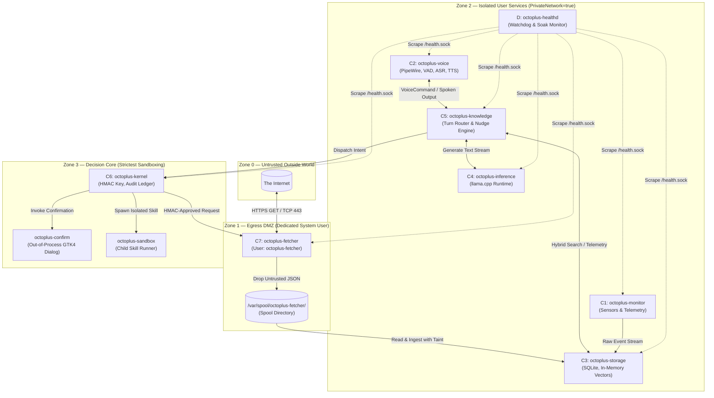

# OctoPlus

> **Renamed from Semantic NeuroOS to OctoPlus on 2026-11-25** (Phase 11.5). Dated reports, decision records (ADRs), `memory.md`, `BUGS.md` history and the old phase plans keep the old name, because it was true when they were written. The old-to-new name table is in `reports/rename-inventory.md`. The GitHub repository keeps its old address until the owner renames it.

**A Sovereign, Ambient, Zero-Egress Cognitive Operating System Companion for Linux.**

> **Status (2026-11-26):** Phases 0-9, 11, 11.5 Part 1 and 12 are done (Phase 10 was skipped by the owner). OctoPlus now includes a companion character, **Laila**, and a desktop dashboard, **OctoPit**. The project is moving to macOS: see [14. Project Roadmap & Delivery Status](#14-project-roadmap--delivery-status).

> *"A buddy that lives in your laptop: it notices things, remembers things, talks like a person, and nothing leaves your machine unless you say yes."*

---

## Table of Contents

- [1. Executive Overview](#1-executive-overview)
- [2. Core Architectural Philosophy & Privacy Invariants](#2-core-architectural-philosophy--privacy-invariants)
- [3. System Architecture & Trust Zones](#3-system-architecture--trust-zones)
- [4. Component Catalogue](#4-component-catalogue)
- [5. Inter-Process Communication (IPC) Fabric](#5-inter-process-communication-ipc-fabric)
- [6. Deep Dive: Subsystems & Daemons](#6-deep-dive-subsystems--daemons)
  - [C1: Context & Health Monitor (`octoplus-monitor`)](#c1-context--health-monitor-octoplus-monitor)
  - [C2: Voice & Audio Pipeline (`octoplus-voice`)](#c2-voice--audio-pipeline-octoplus-voice)
  - [C3: Semantic Storage & In-Memory Vector Search (`octoplus-storage`)](#c3-semantic-storage--in-memory-vector-search-octoplus-storage)
  - [C4: Local Model Inference (`octoplus-inference`)](#c4-local-model-inference-octoplus-inference)
  - [C5: Knowledge Orchestration & Nudge Engine (`octoplus-knowledge`)](#c5-knowledge-orchestration--nudge-engine-octoplus-knowledge)
  - [C6: Safety Kernel & Human Confirmation (`octoplus-kernel` & `octoplus-confirm`)](#c6-safety-kernel--human-confirmation-octoplus-kernel--octoplus-confirm)
  - [C7: Controlled Egress DMZ (`octoplus-fetcher`)](#c7-controlled-egress-dmz-octoplus-fetcher)
  - [D: System Health Watchdog (`octoplus-healthd`)](#d-system-health-watchdog-octoplus-healthd)
  - [Companion Mode: Laila](#companion-mode-laila)
  - [OctoPit: The Desktop Dashboard](#octopit-the-desktop-dashboard)
  - [Operator CLI (`octoplusctl`)](#12-cli-operations-guide-octoplusctl)
- [7. Data Model & Storage Schema](#7-data-model--storage-schema)
- [8. Security Model, Taint Propagation & Sandboxing](#8-security-model-taint-propagation--sandboxing)
- [9. Models & Hardware Accelerators](#9-models--hardware-accelerators)
- [10. Platform Requirements](#10-platform-requirements)
- [11. Build, Installation & Quickstart](#11-build-installation--quickstart)
- [12. CLI Operations Guide (`octoplusctl`)](#12-cli-operations-guide-octoplusctl)
- [13. Development, Verification & Testing Gates](#13-development-verification--testing-gates)
- [14. Project Roadmap & Delivery Status](#14-project-roadmap--delivery-status)
- [15. Specifications & Reports](#15-specifications--reports)

---

## 1. Executive Overview

**OctoPlus** is a fully local, privacy-first ambient assistant designed for modern Linux workstations and laptops running Wayland (COSMIC / wlroots), PipeWire, and systemd.

Unlike cloud-tethered assistants that stream personal data, keystrokes, and audio to remote endpoints, OctoPlus operates under a **zero-egress-by-construction** guarantee:

1. **Senses Continuously**: Non-intrusively samples desktop window focus, user idle state, media playback, git activity, and physical hardware telemetry (NVMe/SATA disk usage, CPU/memory consumption, thermal sensors, battery drain).
2. **Remembers Locally**: Distills transient telemetry into long-term semantic memory stored in a single embedded SQLite database with exact in-memory vector embeddings and FTS5 full-text search.
3. **Speaks Proactively (Nudges)**: Evaluates background telemetry using deterministic, hysteresis-governed rules to alert you *before* problems occur (e.g., thermal throttling, battery depletion, disk saturation, break reminders).
4. **Understands Natural Language**: Resolves deictic references (e.g., *"What error was on my screen just now?"*) by joining spoken timestamps against structured focus history.
5. **Answers with One Consistent Voice**: Streams speech responses sentence-by-sentence, with conversational follow-up windows (no wake word needed after an answer). An answer can be interrupted with the wake phrase; interrupting by plain speech is off by default and planned for the Mac.
6. **Keeps You Company (optional, local)**: A companion character, **Laila**, chats by voice or text, speaks up now and then, tells jokes, and can remember things you ask her to keep. She only talks: she can never act on the computer. See [Companion Mode: Laila](#companion-mode-laila).
7. **Guarantees Privacy & Safety**: Every internal service is denied network access by the Linux kernel. A single sandboxed egress DMZ runs under a separate system user and can execute only one approved web search at a time, strictly verified by cryptographic HMAC tokens and out-of-process GTK4 human confirmations.

---

## 2. Core Architectural Philosophy & Privacy Invariants

The design of OctoPlus is governed by ten inviolable architectural principles:

```
┌─────────────────────────────────────────────────────────────────────────────┐
│                         CORE ARCHITECTURAL PRINCIPLES                       │
├──────┬───────────────────────────────┬──────────────────────────────────────┤
│ AP-1 │ No Egress by Construction     │ Kernel-enforced isolation. Only C7   │
│      │                               │ has network namespace access.        │
├──────┼───────────────────────────────┼──────────────────────────────────────┤
│ AP-2 │ Isolated Unix Processes       │ Seven services + healthd communicate │
│      │                               │ solely via versioned protobuf IPC.   │
├──────┼───────────────────────────────┼──────────────────────────────────────┤
│ AP-3 │ Single Resource Ownership     │ C3 owns storage; C4 owns LLM; C6 owns│
│      │                               │ HMAC key, audit logs & UI dialogs.   │
├──────┼───────────────────────────────┼──────────────────────────────────────┤
│ AP-4 │ Least Privilege (Enforced 2x) │ systemd unit restrictions + Landlock │
│      │                               │ ABI v4 applied at startup.           │
├──────┼───────────────────────────────┼──────────────────────────────────────┤
│ AP-5 │ Monotonic Taint Growth        │ External data stays marked untrusted │
│      │                               │ across merges, summaries, and tools. │
├──────┼───────────────────────────────┼──────────────────────────────────────┤
│ AP-6 │ Propose, Never Decide         │ LLM outputs text/grammar only. Skill │
│      │                               │ actions require C6 safety gating.    │
├──────┼───────────────────────────────┼──────────────────────────────────────┤
│ AP-7 │ Simplicity Before Cleverness  │ Single SQLite WAL database, exact    │
│      │                               │ in-memory scan, no extra engines.    │
├──────┼───────────────────────────────┼──────────────────────────────────────┤
│ AP-8 │ Strict Latency Budgets        │ Every hop has budgeted deadlines; slow│
│      │                               │ work never sits on the audio path.   │
├──────┼───────────────────────────────┼──────────────────────────────────────┤
│ AP-9 │ Graceful Degradation          │ Losing a service drops a feature, not│
│      │                               │ the whole operating system session.  │
├──────┼───────────────────────────────┼──────────────────────────────────────┤
│AP-10 │ External Observability        │ Scraped by an out-of-band daemon;    │
│      │                               │ verified by tamper-evident logs.     │
└──────┴───────────────────────────────┴──────────────────────────────────────┘
```

---

## 3. System Architecture & Trust Zones

Isolation in OctoPlus is organized into four concentric **Trust Zones**:



### Boundary Security Rules
1. **Zone 1 → Zone 2**: Data crosses exclusively via the file spool (`/var/spool/octoplus-fetcher/`). Incoming documents are forcibly assigned the `EXTERNAL_UNTRUSTED` taint flag by C3.
2. **Zone 2 → Zone 1**: Outbound requests are initiated exclusively by C6 upon human approval, cryptographically sealed with a single-use HMAC token (`fetch.key`).
3. **Zone 3 Execution**: Skills run exclusively under `octoplus-sandbox` in dedicated Landlock/seccomp child processes. Visual confirmation dialogs run out-of-process via GTK4.
4. **UID Separation**: Zone 1 runs under `octoplus-fetcher`. Zones 2 and 3 run under the desktop user's UID, isolated from each other via systemd mount namespaces (`TemporaryFileSystem=%t/octoplus` + explicit `BindPaths=`) and Landlock ABI v4 rulesets.

---

## 4. Component Catalogue

| Component | Service Binary | Language | Runtime Scope | Network Isolation | Primary Responsibilities & Ownership |
| :--- | :--- | :--- | :--- | :--- | :--- |
| **C1** | `octoplus-monitor` | Rust | User unit | `PrivateNetwork=true` | Monitors Wayland focus, idle timeouts, MPRIS media, process hierarchy, system resources, and thermals. |
| **C2** | `octoplus-voice` | C++20 | User unit | `PrivateNetwork=true` | Captures audio via PipeWire, Silero VAD, openWakeWord ("hey jarvis"), whisper.cpp ASR, and Kokoro fp32 TTS. Open-mic chat sessions. Interruptible by the wake phrase (barge-in by speech is off by default). |
| **C3** | `octoplus-storage` | Rust | User unit | `PrivateNetwork=true` | Owns all persistent data in one SQLite database (`octoplus.sqlite3`), in-memory dot-product vector matrix, FTS5 lexical index, and ONNX Runtime embedding. |
| **C4** | `octoplus-inference` | C++20 | User unit | `PrivateNetwork=true` | Language model inference using upstream llama.cpp (`Qwen3-4B-Instruct-2507 Q4_K_M`), KV-cache prompt reuse, and BNF grammar enforcement. |
| **C5** | `octoplus-knowledge` | Rust | User unit | `PrivateNetwork=true` | Turn routing, prompt assembly, session context, deictic resolution, token neutralizer, the proactive **Nudge Engine**, and **Companion Mode** (Laila). |
| **C6** | `octoplus-kernel` | Rust / GTK4 | User unit | `PrivateNetwork=true` | Authority boundary: holds `hmac.key`, evaluates capability tiers, spawns `octoplus-confirm` GTK4 dialogs, runs sandboxed skills, and maintains hash-chained audit ledgers. |
| **C7** | `octoplus-fetcher` | Rust | System unit | **TCP 443 Only** (Zone 1) | Dedicated user `octoplus-fetcher`. Token-verified web search & fetch, anti-SSRF IP filtering, DNS pinning, and spool delivery. |
| **D** | `octoplus-healthd` | Rust | User unit | `PrivateNetwork=true` | Out-of-band watchdog; scrapes metrics across all component `/health.sock` endpoints, monitors cgroups, and logs soak stability. |
| **GUI**| `octopit` | Rust / GTK4 | User app | No network code | Desktop dashboard: Overview, Chat (Laila or Assistant), Companion, Backends, Activity, Privacy, Settings. Talks to services only through their sockets; approvals still happen only in the `octoplus-confirm` dialog. |
| **CLI**| `octoplusctl` | Rust | User CLI | Inherits shell | Interactive operator tool for status inspection, chat, skill execution, storage lifecycle jobs, nudge control, and audit verification. |

---

## 5. Inter-Process Communication (IPC) Fabric

All inter-process communication in OctoPlus takes place over **Unix Domain Sockets** using filesystem paths. Abstract sockets and loopback TCP/UDP interfaces are strictly banned.

### 5.1 Enforced Socket Map

Runtime root: `$XDG_RUNTIME_DIR/octoplus/` (permissions `0700`). Every socket occupies its own isolated subdirectory (e.g. `<service>/<socket>/<socket>.sock`) (ADR-0009). Systemd unit files generate restricted mount namespaces where each service binds **only** the subdirectories of the peers it is authorized to call:

```
$XDG_RUNTIME_DIR/octoplus/
├── monitor/
│   ├── stream/stream.sock      # C1 -> C3 (raw event stream)
│   └── control/control.sock    # C1 -> C6, octoplusctl
├── voice/
│   ├── voice/voice.sock        # C2 -> C5 (audio commands & speech chunks)
│   └── control/control.sock    # C2 -> C6, octoplusctl
├── storage/
│   └── storage/storage.sock    # C3 -> C5, C6, octoplusctl
├── inference/
│   └── inference/inference.sock# C4 -> C5 (prompt generation stream)
├── knowledge/
│   └── knowledge/knowledge.sock# C5 -> C2, octoplusctl
├── kernel/
│   └── kernel/kernel.sock      # C6 -> C5, octoplusctl
├── healthd/
│   └── healthd/healthd.sock    # healthd -> octoplusctl
└── <component>/health/health.sock # Scraped exclusively by healthd
```

*Note: C7 fetcher sockets reside in `/run/octoplus-fetcher/` owned by group `octoplus` (permissions `0660`).*

### 5.2 Framing & Wire Envelope

Messages are length-delimited with a **4-byte little-endian unsigned integer** specifying frame payload size, followed by a serialized Protocol Buffers `octoplus.v1.Envelope`:

```protobuf
syntax = "proto3";
package octoplus.v1;

message Envelope {
  uint32 schema_version = 1;  // Contract version
  string trace_id       = 2;  // Trace ID propagated end-to-end
  uint64 request_id     = 3;  // Request ID (0 for push events)
  uint64 sent_at_ns     = 4;  // UTC epoch nanoseconds
  bool   end_of_stream  = 5;  // Terminal frame indicator for streams
  oneof body {
    // 10-19: Common / Ping / Pong / Error
    // 20-39: C1 Monitor events
    // 40-59: C2 Voice commands & audio status
    // 60-99: C3 Storage queries & lifecycle jobs
    // 100-119: C4 Inference prompt & text chunks
    // 120-159: C5 Knowledge turns & nudge triggers
    // 160-199: C6 Kernel evaluate, dispatch & confirmations
    // 200-219: C7 Fetcher search & fetch requests
    // 220-239: D Health status & telemetry reports
  }
}
```

### 5.3 Streaming & Peer Authentication
- **Token Streaming**: Text generated by C4 streams to C5 and C2 as sequential sentence frames with an explicit `end_of_stream = true` marker.
- **Deadlines**: Requests carry strict latency deadlines (e.g. 150 ms for vector queries, 800 ms for wake response).
- **Kernel Peer Checks**: Servers verify peer identity using `SO_PEERCRED` (verifying UID) and validate the caller's systemd unit by reading `/proc/<pid>/cgroup`.

---

## 6. Deep Dive: Subsystems & Daemons

### C1: Context & Health Monitor (`octoplus-monitor`)
Written in Rust. C1 gathers continuous context without screen recording, keylogging, or OCR.
- **Sensor Workers**:
  - **Window Focus**: Tracks active Wayland window `app_id`, title, PID, and focus spans via native COSMIC / wlroots protocols. Excluded windows emit redacted events (empty title/app) to break context cleanly.
  - **User Idle**: Samples Wayland idle status (60 s default timeout) and screen lock state.
  - **Media State**: Monitors MPRIS D-Bus interfaces for media playback, title, artist, and track changes.
  - **Hardware Telemetry**: Probes `/proc` and `/sys` to sample CPU load, memory consumption, highest-memory process, NVMe/SATA filesystem capacities, battery percentage/charge state, and CPU package thermal sensors.
- **Exclusion & Privacy Pause**: Emits nothing during pause mode, followed by a state snapshot upon resumption.
- **Ring Buffers & Replay**: Maintains bounded drop-oldest queues. Supports `--record <file>` to generate HMAC-anonymized dumps for offline regression replay via `octoplusctl replay`.

### C2: Voice & Audio Pipeline (`octoplus-voice`)
Written in C++20 for optimal audio timing and zero-copy signal processing.
- **Capture**: Connects to PipeWire for 16 kHz mono capture. Binds strictly to a designated audio node id.
- **VAD & Wake**: Silero VAD runs continuously (< 3% CPU). openWakeWord triggers on the wake phrase (`"hey jarvis"`).
- **Speech-to-Text**: whisper.cpp (`tiny.en`) transcribes spoken queries immediately following end-of-speech silence (≥ 600 ms).
- **Text-to-Speech**: Kokoro fp32 ONNX synthesizes natural speech sentence-by-sentence in the consistent voice `af_heart`. Preambles (e.g., *"Looking that up..."*) and nudge openers are pre-rendered at startup.
- **Hardware Barge-In**: Immediate audio playback flush within 100 ms when the user speaks over the assistant, instantly notifying C5 to cancel C4 inference.
- **Follow-up Window**: Keeps the microphone open for 8 seconds after speaking to allow fluid conversation without repeating the wake phrase.

### C3: Semantic Storage & In-Memory Vector Search (`octoplus-storage`)
Written in Rust. C3 is the sole custodian of persistent user data.
- **Single SQLite Database**: Operates in WAL mode with `synchronous=NORMAL` and `auto_vacuum=INCREMENTAL`.
- **4-Stage Ingest Noise Filter**:
  1. *Subprocess Collapse*: Groups child build jobs or sub-shells under their root window process.
  2. *Self Filtering*: Drops OctoPlus dialogs and notifications.
  3. *Promotion Gate*: Requires ≥ 3 occurrences or > 5 s of active dwell time to prevent transient window flicker from polluting memory.
  4. *Media Demotion*: Down-ranks background audio/video playback unless explicitly interacted with.
- **Exact Vector Matrix**: Embeds promoted text chunks into 384-dimensional vectors using local `bge-small-en-v1.5` via ONNX Runtime 1.31.1. Vectors are held in a contiguous in-memory float array for sub-5ms exact dot-product scanning (no approximate ANN graph drift).
- **Hybrid Retrieval**: Combines SQLite FTS5 BM25 text rank and dot-product vector scores using **Reciprocal Rank Fusion (RRF)**.
- **Data Lifecycle & Cryptographic Forget**: Daily vacuum GC, hourly telemetry rollups, and atomic snapshot backups (keeps 8 newest). `forget` commands execute in a single ACID transaction, overwriting chunks via `secure_delete` and scrubbing existing backups immediately.

### C4: Local Model Inference (`octoplus-inference`)
Written in C++20, wrapping upstream `llama.cpp`.
- **Model**: Executes `Qwen3-4B-Instruct-2507` (Q4_K_M quantized GGUF).
- **Prompt Cache**: Persists KV-cache across conversational turns for stable prefix blocks (persona, safety constraints, skill definitions).
- **Grammar Constrained Output**: Enforces strict BNF grammars during skill extraction turns to guarantee syntactically valid JSON arguments.
- **Compute Accelerators**: Optimized for AVX2 CPU execution by default (4.2 s p50 response). Optional Vulkan GPU offload on supported hardware (RTX 3050 Mobile VRAM budget: 3,100 MiB).

### C5: Knowledge Orchestration & Nudge Engine (`octoplus-knowledge`)
Written in Rust. C5 manages conversational state and contextual awareness.
- **Deictic Resolution**: Resolves references like *"this"*, *"that"*, or *"the build failure"* by retrieving the window focus containing the timestamp `t_speech_start`.
- **Prompt Assembly**: Fits turns into a strict 384-token budget:
  - 128 tokens: Persona, rules, and skill definitions (cached).
  - 48 tokens: Long-term personal user facts (`profile.remember`).
  - 32 tokens: Resolved desktop focus context.
  - 48 tokens: Multi-turn conversational session history.
  - 128 tokens: Retrieved evidence chunks (wrapped in boundary markers).
- **Deterministic Turn Router**: Evaluates input sequentially:
  1. *Nudge Reply*: Handled with active nudge context if within the follow-up window.
  2. *Action Dispatch*: Grammar-constrained skill formulation sent to C6.
  3. *Desktop/Memory Query*: Grounded answer synthesis using C3 evidence.
  4. *General Conversation*: Direct conversational response.
- **Proactive Nudge Engine**: Evaluates background telemetry every 30 s against TOML rules (disk, battery, thermal, memory, quiet hours). Incorporates hysteresis, debounce windows, and a context policy gate (suppressing speech during calls, fullscreen gaming, or media playback).

### C6: Safety Kernel & Human Confirmation (`octoplus-kernel` & `octoplus-confirm`)
Written in Rust and GTK4. C6 enforces the capability authorization boundary.
- **Capability Tiers**:
  - `SAFE`: Read-only actions (e.g. `system.disk_report`, `memory.search`). Run without confirmation when untainted.
  - `REVIEW`: Sensitive operations (e.g. `system.cleanup`, `web.search`, `notes.append`). Always require explicit human confirmation.
  - `DANGEROUS`: Destructive actions. Require confirmation and a typed verification phrase.
- **Dynamic Taint Escalation**: If context includes `EXTERNAL_UNTRUSTED` data (from web lookups or untrusted window titles), normally `SAFE` operations automatically escalate to `REVIEW`.
- **Out-of-Process GTK4 Confirmation Dialog (`octoplus-confirm`)**:
  - Renders completely outside the requesting service.
  - Deny button has default focus; pressing Enter cannot approve.
  - Allow button activates only after a deliberate human delay.
  - Destructive operations require typing a specific confirmation phrase.
  - Voice approval is architecturally impossible.
- **Cryptographic Nonce Token**: Approvals generate a single-use HMAC-SHA256 token binding `action_id`, `capability`, `args_hash`, and a 120-second expiration.
- **Isolated Skill Runner (`octoplus-sandbox`)**: Executes child skills inside dedicated Landlock sandboxes and seccomp-bpf filter jails.
- **Hash-Chained Audit Ledgers**: Every action generates tamper-evident JSON lines in `actions.jsonl` (and `egress.jsonl` for network access) with SHA-256 rolling block chains.

### C7: Controlled Egress DMZ (`octoplus-fetcher`)
Written in Rust. C7 is the only process on the machine with network namespace access.
- **Dedicated System User**: Runs under the isolated system account `octoplus-fetcher` (group `octoplus`).
- **Authorization Enforcement**: Accepts requests exclusively from C6 containing valid HMAC signatures (`fetch.key`).
- **Anti-SSRF Protection**: Resolves addresses once; aggressively blocks RFC 1918, loopback (`127.0.0.0/8`), carrier-grade NAT (`100.64.0.0/10`), link-local (`169.254.0.0/16`), multicast, and IPv6 unmapped ranges. Pins validated IPs for TLS connections.
- **Single-Turn Execution**: Fetches exactly one approved search or approved URL at a time (up to 3 redirects, re-verified).
- **Spool Output**: Writes clean, size-capped JSON to `/var/spool/octoplus-fetcher/` and immediately exits. It has no read access to user data.

### D: System Health Watchdog (`octoplus-healthd`)
Written in Rust. Runs out-of-band to monitor system integrity.
- Scrapes `/health.sock` on all services every 30 seconds.
- Gathers RSS memory usage, latency distributions, and error counters from Linux cgroups.
- Maintains soak stability history and generates telemetry reports for `octoplusctl status`.

---

### Companion Mode: Laila
Companion Mode is part of C5 and runs on the same local model, with no network access. **Laila** is a 25-year-old AI character who studied computer science and cognitive science. Her head (logic) and heart keep arguing, and you never know which will speak first. She is an AI character and says so plainly whenever you sincerely ask.
- **Persona**: `deploy/persona/laila.toml` (owner-editable, format in `docs/design/persona-format.md`; design in ADR-0019). It holds her story, her little life (day, reads, family, habits), her boundaries, quiet hours and crisis text.
- **Talking to her**: say the wake phrase and talk (a chat session opens; follow-ups need no wake word), or type with `octoplusctl chat`, `octoplusctl ask --companion "..."`, or the OctoPit Chat page (Laila mode is the default there).
- **What she does**: two modes with natural switches; speaks up 2 to 4 times an hour (never 23:00 to 08:00, at most 40 a day, quiet during calls and full-screen use); jokes that adapt to "that was funny" and "not funny"; keeps facts you ask her to keep and, now and then, something she noticed (marked "(noticed)", visible and forgettable in OctoPit); a dependence guard limits talk time.
- **Spoken controls**: "chat more", "chat less", "not now", "be quiet for an hour", "bye".
- **Safety**: she only talks (**DR-1**: her words have no path to any action, enforced by a source-scan test). Crisis words get a fixed, caring message. "Are you real?" always gets the honest answer. Forbidden manipulative phrases ("don't go", "I'll miss you") are filtered. Asked to approve or do something on the computer, she says she cannot. Approvals exist only in the dialog.
- **Limits**: a small 4B model is sometimes flat or long; she remembers only the current chat and the facts she keeps; Hinglish is not built; barge-in by speech is off until the Mac.
- **Evidence**: `reports/phase-12-companion.md`, `reports/phase-12-laila-personality.md`, `reports/phase-12-final-readiness.md`.

---

### OctoPit: The Desktop Dashboard
OctoPit (`crates/octopit` and `crates/octopit-core`, GTK4) is the one place to see and talk to OctoPlus. It has Overview, **Chat** (a Laila | Assistant switch: Laila only talks, Assistant keeps web search, desktop questions and actions with approval), **Companion** (her rhythm, today's talks, switches, and what she remembers with a Forget button), Backends, Activity (including the audit trail), Privacy (what the network ledger shows and the isolation status of every part), and Settings. The Companion page has a Pause button for her. It reaches services only through their sockets, has no network code, and cannot approve anything: approval happens only in the `octoplus-confirm` dialog. Design: ADR-0017; reports: `reports/phase-11-octopit.md`, `reports/phase-12-octopit-chat-laila.md`.

---

## 7. Data Model & Storage Schema

All persistent user data is maintained in a single SQLite database (`~/.local/share/octoplus/storage/octoplus.sqlite3`):

```sql
-- Tracked window focus segments
CREATE TABLE focus_history (
    id INTEGER PRIMARY KEY AUTOINCREMENT,
    app_id TEXT NOT NULL,
    window_title TEXT NOT NULL,
    pid INTEGER NOT NULL,
    started_at_ns INTEGER NOT NULL,
    ended_at_ns INTEGER,
    dwell_ms INTEGER,
    taint_flags INTEGER NOT NULL DEFAULT 0
);

-- Promoted semantic entities
CREATE TABLE entities (
    id INTEGER PRIMARY KEY AUTOINCREMENT,
    domain INTEGER NOT NULL,
    kind TEXT NOT NULL,
    label TEXT NOT NULL,
    taint_flags INTEGER NOT NULL,
    first_seen_ns INTEGER NOT NULL,
    last_seen_ns INTEGER NOT NULL
);

-- Searchable text chunks & embedding vectors
CREATE TABLE chunks (
    id INTEGER PRIMARY KEY AUTOINCREMENT,
    entity_id INTEGER REFERENCES entities(id) ON DELETE CASCADE,
    domain INTEGER NOT NULL,
    chunk_text TEXT NOT NULL,
    taint_flags INTEGER NOT NULL,
    created_at_ns INTEGER NOT NULL,
    embedding BLOB -- 384x float32 binary blob
);

-- Full-text lexical search
CREATE VIRTUAL TABLE chunks_fts USING fts5(
    chunk_text,
    content='chunks',
    content_rowid='id'
);

-- Numeric machine health time series
CREATE TABLE health_samples (
    id INTEGER PRIMARY KEY AUTOINCREMENT,
    metric_id INTEGER NOT NULL,
    value REAL NOT NULL,
    sampled_at_ns INTEGER NOT NULL
);

-- User-declared personal facts
CREATE TABLE profile_facts (
    id INTEGER PRIMARY KEY AUTOINCREMENT,
    fact_text TEXT NOT NULL,
    category TEXT NOT NULL,
    source TEXT NOT NULL,
    created_at_ns INTEGER NOT NULL,
    last_used_at_ns INTEGER
);

-- History of proactive nudges
CREATE TABLE nudge_log (
    id INTEGER PRIMARY KEY AUTOINCREMENT,
    rule_id TEXT NOT NULL,
    delivery_mode INTEGER NOT NULL,
    triggered_at_ns INTEGER NOT NULL,
    outcome INTEGER NOT NULL
);
```

---

## 8. Security Model, Taint Propagation & Sandboxing

### 8.1 Monotonic Taint Propagation

Taint flags track the provenance of all data moving through the system:

```rust
bitflags! {
    pub struct TaintFlags: u32 {
        const EXTERNAL_UNTRUSTED = 1 << 0; // Ingested from C7 fetcher
        const USER_PROVIDED      = 1 << 1; // Directly entered by user
        const MODEL_GENERATED    = 1 << 2; // Produced by local LLM
        const STALE_INDEX        = 1 << 3; // Embedding model changed
    }
}
```

- Invariant: `taint(output) = union(taint(inputs))`
- Taint can never be cleared or reduced by summarization, deduplication, or multi-hop retrieval.
- Any evidence containing `EXTERNAL_UNTRUSTED` forces downstream skill evaluations into `REVIEW` tier.

### 8.2 Defense-in-Depth Sandbox Matrix

```
┌───────────────────┬──────────────┬───────────────┬────────────────────────────────────┐
│ Component         │ Network      │ Landlock (RO) │ Landlock (RW) / Bindings           │
├───────────────────┼──────────────┼───────────────┼────────────────────────────────────┤
│ C1 Monitor        │ None         │ /proc, /sys,  │ Own runtime socket folder          │
│                   │              │ Wayland, D-Bus│                                    │
├───────────────────┼──────────────┼───────────────┼────────────────────────────────────┤
│ C2 Voice          │ None         │ Voice models, │ Own runtime socket folder          │
│                   │              │ PipeWire conf │                                    │
├───────────────────┼──────────────┼───────────────┼────────────────────────────────────┤
│ C3 Storage        │ None         │ ONNX model,   │ SQLite db, backups, own runtime    │
│                   │              │ Spool (RO+del)│ socket folder                      │
├───────────────────┼──────────────┼───────────────┼────────────────────────────────────┤
│ C4 Inference      │ None         │ LLM GGUF,     │ Own runtime socket folder          │
│                   │              │ /dev/nvidia*  │                                    │
├───────────────────┼──────────────┼───────────────┼────────────────────────────────────┤
│ C5 Knowledge      │ None         │ Prompts,      │ Own runtime socket folder          │
│                   │              │ nudges.toml   │                                    │
├───────────────────┼──────────────┼───────────────┼────────────────────────────────────┤
│ C6 Kernel         │ None         │ hmac.key,     │ Audit ledgers, own runtime folder  │
│                   │              │ Wayland/GTK   │                                    │
├───────────────────┼──────────────┼───────────────┼────────────────────────────────────┤
│ C7 Fetcher        │ TCP 443 only │ TLS CA certs  │ Spool dir, /run/octoplus-fetcher    │
├───────────────────┼──────────────┼───────────────┼────────────────────────────────────┤
│ Skill Sandbox     │ None         │ System libs   │ Per-skill allowlisted targets only │
└───────────────────┴──────────────┴───────────────┴────────────────────────────────────┘
```

---

## 9. Models & Hardware Accelerators

All machine learning models are verified by SHA-256 checksums in [`models/manifest.toml`](models/manifest.toml) before loading. Models are never fetched dynamically at runtime.

| Role | Model ID | Artifact / Format | Size | License | Purpose |
| :--- | :--- | :--- | :--- | :--- | :--- |
| **LLM** | `qwen3-4b-instruct-2507` | `Qwen3-4B-Instruct-2507-Q4_K_M.gguf` | 2.50 GB | Apache-2.0 | Conversational answering, context synthesis, skill argument extraction. |
| **Embedding** | `bge-small-en-v1.5` | `bge-small-en-v1.5.onnx` (384-dim) | 133 MB | MIT | Vector representations for C3 semantic memory. |
| **ASR (STT)**| `whisper-tiny-en` | `ggml-tiny.en.bin` | 77.7 MB | MIT | Local speech-to-text transcription. |
| **VAD** | `silero-vad-v6.2.3` | `silero_vad.onnx` | 2.3 MB | MIT | Voice activity detection (< 3% CPU). |
| **Wake Word**| `openwakeword-jarvis` | `hey_jarvis_v0.1.onnx` + mel models | ~5 MB | Apache / CC | On-device wake-word detection. |
| **TTS** | `kokoro-v1.0-fp32` | `kokoro-v1.0-fp32.onnx` (`af_heart`) | 326 MB | Apache-2.0 | High-fidelity local speech synthesis. |
| **Runtime** | `onnxruntime-1.31.1`| `libonnxruntime.so.1.31.1` | 11.4 MB | MIT | Pinned dynamic runtime for ONNX inference. |

### Optional GPU Acceleration (C4)
OctoPlus runs fully on modern AVX2 CPUs. On workstations with dedicated NVIDIA GPUs (e.g. RTX 3050 Mobile), inference offload can be enabled via the Vulkan backend (`BindPaths=/dev/nvidia0 /dev/nvidiactl`, VRAM budget capped at 3,100 MiB) to achieve sub-3s answer generation.

---

## 10. Platform Requirements

### Target Hardware
- **Processor**: x86_64 CPU with AVX2 support (4 cores minimum; 8 cores / 16 threads recommended).
- **Memory**: 16 GB RAM recommended (8 GB supported if model RSS ≤ 1,600 MiB).
- **Disk**: 8 GB free storage space on an SSD/NVMe volume.
- **Microphone & Speakers**: Configured under PipeWire.

### Operating System & Dependencies
- **OS**: Linux kernel ≥ 6.7 (mandatory for Landlock ABI v4 network restrictions).
- **Display Server**: Wayland compositor (COSMIC Desktop, Sway, or wlroots).
- **Audio Server**: PipeWire ≥ 1.0 with PipeWire Pulse compatibility layer.
- **Init System**: systemd ≥ 255 (user service isolation with `TemporaryFileSystem=`).
- **Toolchains**: Rust 1.84+ (edition 2024), GCC 13+ / Clang 17+ (C++20), CMake 3.25+, Ninja, `just`, `protoc`.

---

## 11. Build, Installation & Quickstart

OctoPlus uses `just` as its single entry point.

### Step 1: Install Development Dependencies

On Ubuntu 24.04 / Pop!_OS 24.04:
```bash
sudo apt-get update && sudo apt-get install -y \
    build-essential cmake ninja-build protobuf-compiler \
    libpipewire-0.3-dev libgtk-4-dev libsqlite3-dev \
    libespeak-ng-dev libasound2-dev libseccomp-dev
```

### Step 2: Fetch and Verify Verified Models

Download and verify all SHA-256 pinned models:
```bash
just fetch-models
```

### Step 3: Build the Complete Stack

Build all Rust workspace crates, C++ libraries, and voice pipelines:
```bash
just build
```

### Step 4: Install System Units & Configuration

Install user-level units into `~/.local/` and configure the fetcher user:
```bash
# 1. Generate systemd unit files from the enforced socket map
just units

# 2. Install developer binaries and user services
just install-dev

# 3. Provision the isolated fetcher system user and spool permissions
sudo scripts/install-fetcher.sh
```

### Step 5: Start OctoPlus

Enable and start the user target:
```bash
systemctl --user daemon-reload
systemctl --user enable --now octoplus.target
```

Inspect operational status:
```bash
octoplusctl status
```

---

## 12. CLI Operations Guide (`octoplusctl`)

`octoplusctl` is the operator CLI for managing, inspecting, and querying OctoPlus.

### Health & Telemetry
```bash
# Inspect health, RSS, and socket connectivity across all services
octoplusctl status

# Emit structured machine-readable JSON status
octoplusctl status --json
```

### Ask Questions (CLI Mode)
```bash
# Talk to Laila (companion mode) instead of the plain assistant
octoplusctl chat
octoplusctl ask --companion "tell me about yourself"

# Ask a question via the knowledge and inference pipeline
octoplusctl ask "What did I work on this morning?"

# Display turn routing, evidence retrieval, and taint flags
octoplusctl ask "Why is my laptop fan spinning?" --explain
```

### Nudge Engine Management
```bash
# List all proactive nudge rules and their cooldown states
octoplusctl nudges list

# Temporarily disable or enable a nudge rule
octoplusctl nudges disable disk_space_warning
octoplusctl nudges enable disk_space_warning

# Test-fire a nudge notification or speech sample
octoplusctl nudges test disk_space_warning --voice
```

### Memory & Storage Operations
```bash
# Search persistent memory using hybrid semantic retrieval
octoplusctl storage search "compile error in rustix" --top-k 3

# Trigger immediate background storage lifecycle jobs
octoplusctl storage job gc
octoplusctl storage job backup
octoplusctl storage job rollup
```

### Personal Facts & Memory
```bash
# View remembered facts about user preferences
octoplusctl profile list

# Explicitly store or remove a personal preference
octoplusctl profile add "I prefer dark mode in all applications"
octoplusctl profile remove 1
```

### Security & Audit Verification
```bash
# Inspect recent actions recorded by the safety kernel
octoplusctl audit tail --limit 10

# Cryptographically verify the hash-chained audit ledger
octoplusctl audit verify

# Inspect outbound network requests in the egress ledger
octoplusctl egress list
```

### Telemetry Replay & Harness
```bash
# Replay an anonymized monitor dump at 2x real-time speed
octoplusctl replay dump-20261116.dump --speed 2.0
```

---

## 13. Development, Verification & Testing Gates

Every story and pull request must satisfy the automated gate pipeline:

```bash
# Run the complete test suite (Rust unit tests + C++ ctest)
just test

# Check code formatting (Rustfmt + clang-format)
just fmt-check

# Run linters (clippy, clang-tidy, shellcheck, cargo-machete)
just lint

# Validate dependency licenses and ban policies
just deny

# Measure code coverage (Rust >= 80%, C++ >= 70%)
just cov

# Execute C++ tests under AddressSanitizer and ThreadSanitizer
just sanitize

# Run the three security proofs and verify egress isolation
just sc
```

Live checks on the installed, running stack (after `just install-dev` and
`systemctl --user start octoplus.target`); each prints PASS/FAIL per check:

```bash
tests/scripts/live-input-test.sh          # typed inputs, outputs, injection, concurrency, cancel
tests/scripts/fetcher-netns-test.sh       # C7's real HTTPS transport in a private network namespace (also in `just test`)
scripts/voice-real-stack.sh               # one spoken exchange through virtual audio devices (nothing audible)
scripts/voice-sc-checks.sh                # voice security: strict capture, no audio on disk
scripts/voice-nudge-check.sh              # spoken nudge (UJ-2); run at the keyboard, or it reports HELD
scripts/chaos-injection.sh                # kill and recover every part, mid-answer kill, restart storm
scripts/bench-integrated.sh --voice 6     # NFR-PERF figures from the live stack; unmeasured items say so
scripts/soak-24h.sh --hours 24            # NFR-REL-04; runs under 4 h are reported "not asserted"
```

---

## 14. Project Roadmap & Delivery Status

Delivery follows numbered phases; each phase ends with a report in `reports/`, a green `just ci`, and the owner's sign-off. The live tracker is in [`memory.md`](memory.md) (section 3); the plan for what comes next is [`docs/plans/master-plan-11-5-to-20.md`](docs/plans/master-plan-11-5-to-20.md).

| Phase | Description | Status | Deliverables & Milestones |
| :---: | :--- | :---: | :--- |
| **0** | **Spikes & Foundations** | ✅ Done | Architecture baseline, SQLite FTS5/vector scan spike, model bake-off (`Qwen3-4B`), systemd Landlock hardening. |
| **1** | **Walking Skeleton** | ✅ Done | All services running under `octoplus.target`, IPC framing, `healthd` watchdog, initial security proofs. |
| **2** | **Safety Kernel (C6)** | ✅ Done | `hmac.key` binding, GTK4 dialog (`octoplus-confirm`), capability registry, hash-chained audit ledgers. |
| **3** | **Context Monitor (C1)** | ✅ Done | Wayland focus tracking, idle/lock sensors, hardware sampling, privacy pause, anonymized dump recorder. |
| **4** | **Semantic Storage (C3)** | ✅ Done | SQLite WAL database, 4-stage noise filter, `bge-small-en-v1.5` exact vector scan, cryptographic forget/purge. |
| **5** | **Knowledge & Chat (C5)** | ✅ Done | Turn routing, deictic resolution, 384-token prompt assembler, control-token neutralizer, session history. |
| **6** | **Nudge Engine** | ✅ Done | Background rule evaluator (disk, battery, thermal, memory), cooldowns, quiet hours, context policy gate. |
| **7** | **Voice Pipeline (C2)** | ✅ Done | PipeWire 16 kHz capture, Silero VAD, openWakeWord, whisper.cpp ASR, Kokoro fp32 TTS (`af_heart`). |
| **8** | **Controlled Fetcher (C7)** | ✅ Done | Real HTTPS transport, SSRF gate, token verification, search provider. Signed off 2026-11-25. |
| **9** | **Integration & Soak** | ✅ Done | Chaos and recovery, live input/voice checks, measured benchmarks, soak under the v2 rule. Signed off 2026-11-25. |
| **10** | **Packaging & Release** | ⏭ Skipped | Skipped by the owner; the installer, `.deb` work and runbooks that exist stay in the repo. Licence: GPL-3.0-only (D-44). |
| **11** | **OctoPit (GTK4 dashboard)** | ✅ Done | Overview, Chat, Backends, Activity, Privacy, Settings, mic button. Signed off 2026-11-25. |
| **11.5** | **Rename to OctoPlus** | ✅ Part 1 done | Renamed from Semantic NeuroOS on 2026-11-25. **Part 2 (Mac readiness, including the export tool) is next.** |
| **12** | **Companion (Laila)** | ✅ Done | Laila, open-mic chat sessions, Pulse (speaks up), humour, memory of the owner, OctoPit Companion page and Chat in Laila mode, safety verification. Signed off and merged 2026-11-26. Hinglish skipped; barge-in by speech deferred to the Mac. |
| 13 | Cloud models behind a privacy gate, encrypted storage, local/cloud switch | ⬜ Planned | Local stays the default; cloud models never see storage. |
| 14 | Skills library | ⬜ Planned | |
| 15 | Conversion to a macOS-only app | ⬜ Planned | The project moves to the owner's Mac; a sale gate protects the data on the Linux laptop. |
| 16-19 | OctoPit as the one interface, silent chat, agent mesh, spatial awareness | ⬜ Planned | |
| 20 | Polish, security testing, long soak, release | ⬜ Planned | Always last. |

Evidence: the phase reports in [`reports/`](reports/), starting with [`reports/phase-12-final-readiness.md`](reports/phase-12-final-readiness.md), and the hardening audit [`reports/hardening-audit-2026-11-22.md`](reports/hardening-audit-2026-11-22.md).

---

## 15. Specifications & Reports

For detailed implementation and design documents, refer to the project specifications:

- [`PRD.md`](PRD.md): Product requirements, numeric latency targets, and resource budgets.
- [`Architecture.md`](Architecture.md): Complete system architecture, IPC contracts, and component designs.
- [`security.md`](security.md): Threat model (STRIDE), cryptographic protocols, and sandboxing proofs.
- [`design.md`](design.md): Persona voice guidelines, confirmation dialog UX, and nudge rule definitions.
- [`rules.md`](rules.md): Binding engineering rules, quality standards, and Definition of Done.
- [`memory.md`](memory.md): Project state, phase tracker, decisions log (D-1 to D-85), open items and session log. Read this first when picking the project up.
- [`docs/adr/`](docs/adr/): Architectural Decision Records (ADR-0001 through ADR-0019, including ADR-0017 OctoPit and ADR-0019 Companion Mode).
- [`BUGS.md`](BUGS.md): Known issues, root cause analyses, and tracked resolutions.
- [`docs/plans/`](docs/plans/): Phase plans, the master plan for Phases 11.5 to 20, and the Linux laptop retirement checklist.
- [`reports/`](reports/): One report per finished phase, plus benchmark and test-run evidence in `reports/bench/`.
- [`docs/business-plan.md`](docs/business-plan.md), [`docs/model-optimization-strategy.md`](docs/model-optimization-strategy.md), [`docs/octoplus-ultimate-vision.md`](docs/octoplus-ultimate-vision.md): The owner's business plan, model strategy and long-term vision.

---

## License

**GPL-3.0-only** — see [`LICENSE`](LICENSE). The owner chose GPL-3.0 on 2026-11-22 (D-44) because `octoplus-monitor` statically links the GPL-3.0-only `cosmic-protocols` crate and the voice part uses the GPL-3.0 `espeak-ng` library (risk R-07, now closed). Third-party components and model weights keep their own licences: [`docs/LICENSES.md`](docs/LICENSES.md), [`models/manifest.toml`](models/manifest.toml), [`deny.toml`](deny.toml).
