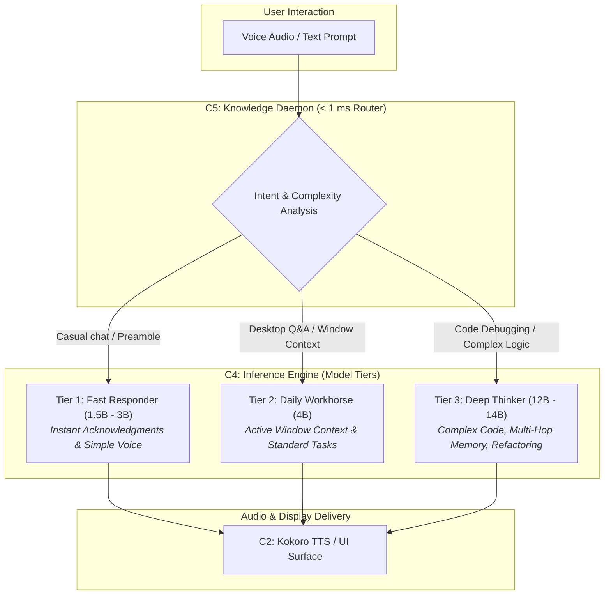

# Hierarchical Multi-Model Architecture & Smart Fast-Switching

**Document Type:** Architecture & Design RFC  
**Target Subsystems:** C4 (`octoplus-inference`), C5 (`octoplus-knowledge`), C2 (`octoplus-voice`)  
**Status:** Proposed / Future Roadmap  
**File Location:** `docs/multi-model-smart-switching.md`  

---

## 1. Executive Summary

OctoPlus currently utilizes a single, balanced local language model (**Qwen3-4B-Instruct-2507 Q4_K_M**) pinned in [`models/manifest.toml`](../models/manifest.toml). 

While a 4B model achieves an optimal balance on standard CPU hardware (sub-3.5s latency to speech, < 3,000 MiB RSS footprint), production workloads naturally present two conflicting demands:
1. **Low-Latency Voice Interactions:** Real-time conversational responsiveness requiring token generation in < 1–2 seconds.
2. **Deep Analytical Reasoning:** Complex code debugging, multi-hop document retrieval, and robust grammar-constrained tool arguments that benefit significantly from larger models (12B–14B parameters).

This document outlines the **Hierarchical Multi-Model Architecture** and **Smart Fast-Switching** mechanism for OctoPlus, detailing how diverse model tiers can be dynamically selected per query, how hardware memory bottlenecks are solved (including on unified memory architectures), and the platform abstraction required for cross-platform deployment.

---

## 2. The Trade-Off: 4B vs. 12B Models on Local Hardware

Benchmarked against the project's baseline hardware (AMD Ryzen 7 5800H, 16 GB RAM, AVX2):

| Dimension | 4B Model (`Qwen3-4B-Instruct`) | 12B–14B Model (e.g. `Mistral-NeMo-12B`, `Qwen2.5-14B`) |
| :--- | :--- | :--- |
| **Model Weight File** | ~2.50 GB (Q4_K_M) | ~7.50 – 8.80 GB (Q4_K_M) |
| **Process RSS (C4)** | ~2,770 MiB (fits inside 3,000 MiB cap) | ~9,000 – 10,500 MiB (strains 16 GB hosts; OOM on 8 GB) |
| **CPU Decode Speed** | ~12.0 tokens/second | ~3.0 – 5.0 tokens/second |
| **Time to First Spoken Audio**| ~2.5 – 3.5 seconds | ~7.0 – 12.0 seconds (awkward dead air for voice) |
| **Reasoning Depth** | Strong for simple desktop Q&A | Exceptional for deep syntax analysis & multi-file bugs |
| **Skill Argument Precision** | ~40–55% exact arg match in zero-shot | Significantly higher instruction adherence |
| **Thermals & Battery** | Mild burst; negligible battery drain | High sustained CPU package power; loud cooling fans |

**Conclusion:** Running exclusively on 4B caps analytical intelligence, while running exclusively on 12B breaks real-time conversational voice responsiveness. A multi-tier architecture solves both.

---

## 3. Tiered Model Topology



### Tier Specifications

1. **Tier 1: The Fast Responder (1.5B – 3B)**
   - *Candidates:* SmolLM2-1.7B, Qwen2.5-1.5B/3B.
   - *Role:* Instant chit-chat, small talk, time/date checks, and immediate spoken preambles.
   - *Latency:* < 1.0s to first token. Memory: ~1.2 – 1.8 GB RSS.

2. **Tier 2: The Daily Workhorse (4B)**
   - *Candidates:* Qwen3-4B-Instruct-2507 (Current Baseline).
   - *Role:* Desktop context synthesis ("What is this?"), everyday note searches, system status reports, and single-step skill calls.
   - *Latency:* ~2.5s to first token. Memory: ~2.8 GB RSS.

3. **Tier 3: The Deep Thinker (12B – 14B)**
   - *Candidates:* Mistral-NeMo-12B, Qwen2.5-14B.
   - *Role:* Multi-turn programming errors, deep semantic retrieval across 20+ memory chunks, complex multi-argument skill execution, and fallback when Tier 2 expresses uncertainty.
   - *Latency:* Heavy compute; invoked selectively.

---

## 4. Smart Fast-Switching & Streaming Preamble Pattern

To preserve conversational flow during heavy reasoning, C5 and C4 implement the **Speculative Preamble Pipeline**:

```
User: "Why is this Rust compilation failing with an E0382 borrow checker error?"
  │
  ├── [0.0 ms]  C5 Router detects "code_debugging" intent (Routes to Tier 3)
  ├── [1.0 ms]  C5 triggers Tier 1 (or template) for an instant spoken preamble:
  │              -> Tier 1 produces: "Let me check the borrow lifetime in your editor..."
  ├── [800 ms]  C2 (Kokoro TTS) begins playing the preamble voice audio to user.
  │
  ├── [0 - 2.5s] Simultaneously in background: Tier 3 processes compiler output + code chunks.
  ├── [2.5 s]   Tier 3 outputs high-quality explanation and fix.
  └── [2.8 s]   C2 smoothly transitions into speaking the solution.
```

**User Experience Impact:** The user hears an immediate, context-aware verbal acknowledgment within 800 ms. The 2-3 second latency of the larger model is masked completely.

---

## 5. Hardware Strategies & Memory Management

### 5.1 Standard Linux x86 Laptops (16 GB RAM Limit)
On typical Linux machines, holding 1.5B + 4B + 12B in active physical memory simultaneously consumes ~14 GB, risking swap thrashing or system OOM:
* **Tier 1 & Tier 2:** Pinned resident in memory (combined footprint ~4.0 GB).
* **Tier 3 (Cold `mmap`):** The 12B weights are mapped with `MAP_SHARED` via `llama.cpp`. They are not locked into RAM (`mlock=false`).
* Modern NVMe PCIe Gen 4 SSDs read at 3,500–5,000 MB/s. Activating the 12B model streams needed weight pages within **1.5 to 2.0 seconds**. Linux page caches automatically evict clean weight pages when application memory is needed.

### 5.2 Apple Silicon Unified Memory Architecture (24 GB+ RAM)
On Apple Silicon hardware with 24 GB Unified Memory:
* **Zero RAM Bottleneck:** Tier 1/2 (~3 GB) and Tier 3 (~8.5 GB) reside **simultaneously in Unified Memory**, leaving > 12 GB for macOS, development tools, and user software.
* **Metal Acceleration (`GGML_METAL=ON`):** With unified memory bandwidth reaching 100–150+ GB/s, Tier 3 runs at **35–50 tokens/second** on the integrated GPU.
* The 12B model responds at the speed of a 4B CPU model while maintaining high analytical fidelity.

---

## 6. macOS Platform Adaptation Map

While OctoPlus is built natively for Linux kernel interfaces (Landlock, systemd, Wayland, PipeWire), its modular Unix Domain Socket (UDS) architecture allows clean platform targeting for a future macOS adaptation:

| Subsystem | Linux Baseline (Current) | macOS Target Architecture |
| :--- | :--- | :--- |
| **C1 Monitor** | Wayland protocols + `/proc` + D-Bus | Cocoa `NSWorkspace` + Accessibility API (`AXUIElement`) |
| **C2 Voice** | PipeWire 1.0 C++ API | CoreAudio / AudioToolbox (`cpal` / `miniaudio`) |
| **C3 Storage** | SQLite + FTS5 + ONNX Runtime | Identical (compile Rust for `aarch64-apple-darwin`) |
| **C4 Inference**| `llama.cpp` CPU / Vulkan | `llama.cpp` compiled with Apple Metal (`GGML_METAL=ON`) |
| **C5 Knowledge**| Rust intent router & prompt assembly | Identical (100% portable Rust crate) |
| **C6 Safety** | Linux Landlock v4 + `seccomp-bpf` | macOS Sandbox (`sandbox_init` / Seatbelt profiles) |
| **Init / Service** | `systemd 255` user units | `launchd` LaunchAgents (`~/Library/LaunchAgents/`) |

---

## 7. Implementation Roadmap

1. **Phase A (C4 Multi-Instance Pool):** Extend `octoplus-inference` to manage multiple `llama_model` pointers behind a unified IPC protocol.
2. **Phase B (C5 Router Tier Mapping):** Update `crates/knowledge/src/router.rs` to output a `ModelTier` tag (`Tier1_Fast`, `Tier2_Standard`, `Tier3_Reasoning`) alongside route intent.
3. **Phase C (Preamble Engine):** Implement overlapping audio streaming in `octoplus-voice` (C2) to play acknowledgments during Tier 3 model prefill.
4. **Phase D (Metal Engine Profile):** Add a CMake build preset for `GGML_METAL` alongside the existing CPU and Vulkan targets.
