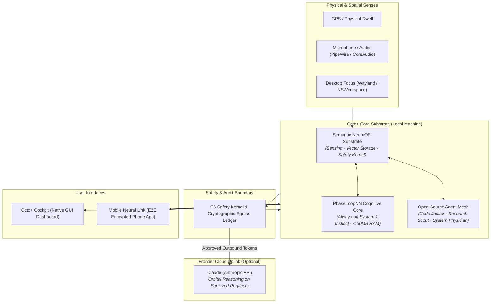

# Octo+: The Sovereign Cognitive Operating System

**Document Type:** Vision, Architecture & Master Roadmap RFC  
**System Designation:** `Octo+` (Next-Generation AI Operating System)  
**File Location:** `docs/octo-plus-vision.md`  
**Status:** Approved Vision & Architectural Specification  

---

## 1. Executive Summary

**Octo+** is a sovereign, spatially-aware cognitive operating system that integrates local systems architecture, novel neural mechanics, hybrid frontier intelligence, and an encrypted mobile remote link into a single, unified computing organism.

Inspired by the cephalopod nervous system—where a central cognitive core works in harmony with semi-autonomous, highly adaptive limbs—**Octo+** blends:
1. **The Physical Anatomy:** The deterministic, kernel-isolated daemons of **Semantic NeuroOS**.
2. **The Biological Brain:** The ultra-compact, compute-reusing recurrent core of **PhaseLoopNN**.
3. **Spatial Awareness:** Ambient physical dwell tracking and location-based proactive suggestions via GPS.
4. **Orbital Cloud Uplink:** A cryptographically audited, sanitized bridge to frontier cloud models (**Claude**).
5. **Open-Source Agent Mesh:** Sandboxed autonomous agents executing specialized system and research tasks.
6. **Unified Hermetic Packaging:** Single-bundle distribution (`.app` / `.deb`) with a native GUI Cockpit.
7. **Mobile Neural Link:** End-to-end encrypted peer-to-peer control of your laptop from anywhere on Earth.

---

## 2. High-Level System Architecture

---

## 3. The Core Pillars of Octo+

### Pillar 1: The OS Substrate (Semantic NeuroOS)
* **Zero-Network Isolation by Default:** Every core daemon touches user data under strict kernel isolation (`Landlock ABI v4` on Linux, `Seatbelt / App Sandbox` on macOS).
* **Episodic Memory Matrix:** SQLite WAL database storing full-text search (FTS5) alongside dense 384-dimensional vector embeddings (`bge-small-en-v1.5`), strictly capped at 30,000 chunks (≤ 2 GB disk).
* **Deterministic Safety Kernel (C6):** Actions are categorized into `SAFE`, `REVIEW`, and `DANGEROUS` tiers. Destructive actions require explicit visual confirmation dialogs.

### Pillar 2: The Biological Neural Core (PhaseLoopNN)
* **Decoupled Thinking and Knowing:** Separates compute-heavy logic from encyclopedic memory.
* **Recurrent Think Block:** Loops 2 to 6 times at each word, achieving the reasoning depth of a 5× to 10× larger model with a memory footprint under **50 MB of RAM**.
* **State & Order Tracking:** Uses clock-hand turning and mirror-flip reading lines to track chronological user workflows without token-scrambling.
* **Continuous Ambient Cognition:** Runs inside the CPU L3 hardware cache 24/7 without fan noise, thermal throttling, or battery drain.

### Pillar 3: Real-Time Spatial & Physical Awareness
* **Physical Dwell Tracking:** Combines screen focus tracking with GPS coordinates (via CoreLocation / GeoClue) to understand real-world context (e.g., home, office, cafe, transit).
* **Proactive Geospatial Suggestions:** Suggests nearby spots (e.g., quiet workspaces, coffee shops) based on physical location and personal habits.
* **Geotagged Episodic Memory:** Recalls past work by physical location (*"What was the git branch I worked on at the library on Friday?"*).

### Pillar 4: Sovereign Orbital Uplink (Secure Claude Bridge)
* **Isolated Egress DMZ:** All external network access is restricted to the dedicated Fetcher daemon (`C7`).
* **Sanitized Token Payloads:** When a task exceeds local parameter capacity, Octo+ automatically strips private credentials and personal identifiers.
* **Explicit User Approval:** A visual confirmation prompt shows the exact prompt tokens and endpoint before any data leaves the device.
* **Cryptographic Egress Ledger:** Every outbound byte is logged to an immutable, inspectable audit trail.

### Pillar 5: Open-Source Agent Mesh
* **Specialized Autonomous Limbs:** Micro-agents running in restricted child sandboxes:
  * **Code Janitor:** Analyzes git diffs, catches build bugs, and pre-runs test suites.
  * **Intelligence Scout:** Performs verified web lookups and document extraction without ad trackers.
  * **System Physician:** Monitors thermals, prunes build caches, and optimizes power states.

---

## 4. Hermetic Native Packaging

Rather than an open folder of loosely managed scripts, **Octo+ is packaged as a monolithic, self-contained distribution**:

* **macOS Distribution (`Octo+.app` / `.dmg`):**
  * Single drag-and-drop installation into `/Applications`.
  * Automatically provisions background `launchd` LaunchAgents.
  * Self-verifying SHA-256 integrity checks for all pinned model files on first launch.
  * Sandboxed user storage under `~/.octo/`.
* **Linux Distribution (`.deb` / Flatpak):**
  * Single-command setup configuring systemd user units, permission profiles, and socket directories.
* **Zero External Dependencies:** Ships with bundled ONNX Runtime, embedded SQLite, and compiled C++/Rust binaries.

---

## 5. The Octo+ Cockpit (Native GUI Dashboard)

A sleek, hardware-accelerated dashboard (built with Slint / Metal / SwiftUI) that provides full transparency into the operating system:

1. **System Vitals & Neural Load:**
   * Live gauges for CPU, Metal GPU, Neural Engine (NPU) usage, thermal headrooms, and battery draw.
2. **The 3D "Memory Galaxy":**
   * An interactive visualization of episodic memories, active window nodes, and personal knowledge clusters stored in SQLite. Users can click any node to inspect, search, or purge it.
3. **Cryptographic Firewall & Egress Radar:**
   * Real-time visual ledger showing network traffic (which remains zero until an approved fetch occurs).
4. **Cognitive Performance Dials:**
   * Real-time metrics tracking speech-to-text latency, PhaseLoopNN loop settling counts, and token generation speeds.

---

## 6. Interaction Modalities: Voice & Stealth Silent Chat

Octo+ adapts dynamically to the user's physical environment with two seamless modes:

### 6.1 Hands-Free Voice Mode (Private / Open Environments)
* **Trigger:** Wake word (*"Hey Jarvis"* / *"Hey Octo"*).
* **Delivery:** Full duplex voice streaming via Whisper ASR and Kokoro TTS.
* **Barge-In:** Hardware audio loopback permits speaking over Octo+ to redirect or interrupt answers instantly.

### 6.2 Stealth Silent Chat Mode (Libraries, Meetings, Public Transit)
When speaking aloud is impractical, Octo+ pivots instantly into a quiet text chat interface without losing any system or desktop intelligence:
* **Summon via Hotkey:** A global shortcut (`Cmd + Space` / `Super + Space` or a three-finger trackpad swipe) summons a lightweight floating command bar / drawer directly over whatever you are working on (Raycast / Spotlight style).
* **Text Prompts with Full Desktop Context:** You can type queries like:
  * *"Why is this compile failing?"* (Octo+ resolves *"this"* to your background editor/terminal).
  * *"Summarize this PDF."*
* **Silent Output Delivery:** Responses stream silently as markdown in the drawer, or as discrete desktop notification cards. Kokoro TTS and microphone audio capture are automatically muted.
* **Quiet Nudges:** Proactive system alerts (e.g. low disk, battery drain) switch from spoken alerts to silent desktop banners with interactive action buttons.
* **Mobile Silent Chat:** On mobile, switching your phone to silent/vibrate automatically switches the mobile link into a quiet, encrypted text messaging view.

---

## 7. Octo+ Mobile Neural Link (Remote P2P Bridge)

An end-to-end encrypted remote bridge that turns your laptop into a sovereign, pocket-accessible private intelligence:

### 6.1 Cryptographic Security
* **Zero Third-Party Relays:** Direct peer-to-peer connection over the **Noise Protocol / WireGuard (Curve25519)**.
* **Air-Gapped Pairing:** One-time pairing between phone and laptop via an on-screen QR code handshake.

### 6.2 Mobile Capabilities
* **Remote Voice Companion:** Talk through your phone or earbuds; audio is streamed to the laptop, processed on its M-series chip, and streamed back in real time.
* **Anywhere Task Dispatch:** Trigger heavy tasks remotely (*"Octo+, pull branch `v2-refactor`, run all unit tests, and ping me with results"*).
* **Remote Safety Confirmations:** Sensitive actions (deleting cache, sending queries to Claude) send a push notification with a 1-tap confirmation dialog.
* **Ambient Sensor Synchronization:** Streams phone GPS coordinates to the laptop so Octo+ maintains physical environmental context on the go.

---

## 8. Target Hardware & Deployment Profile

| Component | Target Specification |
| :--- | :--- |
| **Primary Target** | **Apple MacBook Air (M4 / M5 with 24 GB Unified Memory)** |
| **Chassis Acoustics**| **100% Fanless & Silent** |
| **Battery Life Target** | **15–18 Hours Continuous Operation** |
| **Memory Allocation**| • PhaseLoopNN: ~50 MB • NeuroOS Daemons + SQLite: ~400 MB • Deep LLM (Standby): ~8.5 GB • Free Workstation RAM: **> 14 GB** |
| **Voice Latency** | **< 300 ms to First Spoken Word** |
| **Network Default** | **Completely Offline (Air-Gapped by Kernel)** |

---

## 9. Development Roadmap

1. **Phase 1 (Foundations):** Complete Semantic NeuroOS baseline and PhaseLoopNN 3M–26M prototype.
2. **Phase 2 (Packaging & Cockpit):** Build unified installer bundle and native visual dashboard.
3. **Phase 3 (Mobile Bridge):** Implement Noise Protocol P2P socket bridge for iOS and Android.
4. **Phase 4 (Frontier Uplink & GPS):** Integrate authenticated Claude bridge and GeoClue / CoreLocation hooks.
5. **Phase 5 (Scale):** Scale PhaseLoopNN toward 1B parameter unified cognition.
