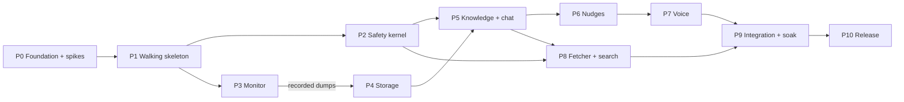

# phases.md — Delivery Plan

**Document version:** 2.0 · **Date:** 2026-11-14 · **Status:** Baseline for the rebuild
**Traceability:** stories → [PRD.md](PRD.md) requirement IDs → tests → exit criteria → `reports/`
**State tracking:** [memory.md](memory.md)

---

## 1. How We Work

### 1.1 The loop for every story

1. **Plan** — Claude turns the story into small tasks and writes agy's instructions: goal, files to change, files not to touch, rules that apply, how to check, and the required REPORT section.
2. **Build** — agy writes the code and tests and runs them.
3. **Check** — Claude reads the real diff, reruns the checks, and runs the service in its real unit. Anything wrong goes back to agy with the cause.
4. **Record** — Claude updates [memory.md](memory.md) with builder and checker, then commits and pushes.
5. **Decide** — anything that changes the outcome goes to the owner.

### 1.2 Definitions

- **Story Ready:** has an ID, a user-story sentence, linked requirement IDs, testable acceptance criteria, and no blocking open question.
- **Story Done / Phase Done:** [rules.md](rules.md) §2. The short version: it runs as a real sandboxed service, it was checked by someone other than the builder, and the full gate ran green to the end.

### 1.3 Phase gate

At the end of each phase Claude verifies every exit criterion with evidence (test output, benchmark JSON, log excerpt, screenshot), writes `reports/phase-NN-<slug>.md` with a plain-language summary and a technical one, and asks the owner to sign off. No timeline is promised here; progress is tracked in [memory.md](memory.md).

### 1.4 Test levels

| Code | Level | Purpose |
| :--- | :--- | :--- |
| UT | Unit | Functions and modules alone |
| PT | Property | Invariants over random inputs |
| CT | Contract | Messages round-trip Rust ↔ C++; servers honour the contract |
| IT | Integration | The real binary in its real unit, with real or mock peers |
| PF | Performance | Against PRD §6, under [rules.md](rules.md) §9 |
| SC | Security | A row of [security.md](security.md) §8 |
| FI | Fault injection | Crash, restart, slow peer, full disk, corrupt input |
| MS | Mini-soak | 1–4 h under realistic load |
| E2E | End to end | User journeys UJ-1 … UJ-6 |
| AT | Acceptance | Owner trial or grading |

---

## 2. Roadmap

| Phase | Name | Parts | Milestone |
| :--- | :--- | :--- | :--- |
| 0 | Foundation and spikes | repo, contracts, CI, shared libraries | M0 |
| 1 | Walking skeleton | all parts as thin real services | M1 |
| 2 | Safety kernel | C6, dialog, skill runner, notifications | M2 |
| 3 | Monitor | C1 with health sensors | M2 |
| 4 | Storage | C3 | M2 |
| 5 | Knowledge and conversation | C5, C4 complete, personal facts — by text | M3 |
| 6 | Nudge engine | C5 nudges, C6 notifications | M4 |
| 7 | Voice | C2, spoken nudges | M5 |
| 8 | Fetcher and search | C7, egress ledger | M6 |
| 9 | Integration, security verification, 24 h soak | all | M7 |
| 10 | Packaging and release | all | M7 |

**Why this order**

- **Spikes first:** the model, the storage design and the sandbox mechanism each decide numbers that everything else depends on.
- **Skeleton second:** every part exists as a real sandboxed service from the start, so integration is continuous, not a late surprise.
- **Safety kernel before features:** every later feature is born behind the gate.
- **Monitor before storage:** storage's noise gate is tested on real recorded dumps.
- **Text before voice:** answers and nudges are proven by text and notification before audio is added.

---

## 3. Phase 0 — Foundation and Spikes

**Goal:** a repository where anything can be built, tested and sandboxed from day one, and five measured answers to the riskiest questions.
**Report:** `reports/phase-00-foundation.md`

### 3.1 Build

1. Fresh **private** repository; folder tree from [Architecture.md](Architecture.md) §16; `.gitignore` for models, data, keys, recordings.
2. Toolchains: Rust workspace, CMake presets, pinned versions.
3. `justfile`: `build`, `test`, `lint`, `fmt`, `cov`, `bench`, `deny`, `ci`, `fetch-models`, `prune`, plus a disk-space pre-flight.
4. Hosted CI workflow for format, lint, build, unit tests and `cargo deny`.
5. Contracts v1: envelope, common, health, and first-cut messages for every part; code generation for Rust and C++.
6. Shared libraries: `neuroos-common`, `-ipc` (framing, server, client, peer checks, deadlines, reconnect, streaming, accept-error handling), `-health`, `-taint`, `-sandbox`, `-testkit`; `cpp/libneuroos` with the same IPC and health behaviour.
7. `deny.toml` with the licence allowlist and the network-crate ban.
8. `models/manifest.toml` and `scripts/fetch-models.sh` with hash verification.
9. `BUGS.md`, `reports/_TEMPLATE.md`, ADR template.
10. **Spikes S-01 … S-05** ([Architecture.md](Architecture.md) §17), each ending in an ADR.

### 3.2 Stories

| ID | Story | Reqs |
| :--- | :--- | :--- |
| P0-S01 | As the operator, `just ci` is green on a clean clone and hosted CI is green on push. | NFR-OPS-02 |
| P0-S02 | As a developer, I define a message once and use it from Rust and C++. | R0-11 |
| P0-S03 | As a part author, I get a socket server and client with framing, streaming, deadlines, peer checks and reconnect. | NFR-REL-01, AB-9 |
| P0-S04 | As a part author, I get a health endpoint that reports real status. | FR-HLT-02 |
| P0-S05 | As a developer, the build fails if any crate but the fetcher links a network crate. | NFR-SEC-03 |
| P0-S06 | As the operator, I fetch and verify every model with one command. | NFR-SEC-05 |
| P0-S07 | **S-01:** storage scan speed and C3 weight at the chunk cap are measured. | NFR-PERF-04 |
| P0-S08 | **S-02:** the model bake-off is run and the owner picks the model. | NFR-PERF-02/03, FR-INF-01 |
| P0-S09 | **S-03:** streamed frames over the socket are measured, including cancel. | NFR-PERF-11 |
| P0-S10 | **S-04:** hardening stanzas, socket-folder isolation and peer-unit checks are proven in user units; the smallest GPU device access for C4 is found. | NFR-SEC-01/02, FR-INF-08 |
| P0-S11 | **S-05:** disk, battery, heat, fullscreen and microphone-in-use signals are read on this machine. | FR-MON-01/05/06/07, FR-VOI-10 |

**S-02 bake-off protocol.** Candidates: one BitNet-class model and at least two small 4-bit instruct models, all on the pinned upstream llama.cpp; the exact list and their licences are confirmed at the start of the spike. Each is scored on: a small held-out grounded-answer set and a general-chat set (owner-graded); honesty when it does not know; grammar-limited JSON reliability; prefill and decode speed at the provisional prompt layout; RSS. Floors, on the CPU alone: fits the C4 cap in PRD §6.2; licence acceptable for a personal install. Each candidate is then run with GPU offload (ADR-0008) on the Vulkan backend and, if the owner approves the install, the CUDA backend: prefill and decode speed, VRAM used, fallback when VRAM is short, power draw when idle with the model loaded. The ADR then fixes the model, the prompt layout, NFR-PERF-02/03 and the memory totals together.

### 3.3 Tests

| Level | Tests |
| :--- | :--- |
| UT | Framing with truncated, oversized and maximum frames; config rejects unknown keys; time conversions. |
| PT | Framing round-trip; taint union is associative, commutative, idempotent. |
| CT | Every v1 message round-trips Rust → C++ → Rust byte-identically; a streamed response ends with an end frame on success, cancel and error. |
| IT | Echo service in a sandboxed user unit: connects, survives a bad peer, reconnects after restart. |
| SC | Probe crate triggers the network ban; inside the test unit TCP, DNS and raw sockets fail while local sockets work. |
| PF | IPC round-trip p99; spike measurements per [rules.md](rules.md) §9. |

### 3.4 Exit criteria

- [ ] `just ci` green on a clean clone; hosted CI green.
- [ ] Contracts generate and pass round-trip tests.
- [ ] `neuroos-ipc` coverage gate met; every decision in framing and peer checking tested.
- [ ] Spikes S-01 … S-05 complete; ADR-0001 … 0008 written and accepted by the owner.
- [ ] PRD §6 updated from the spike results (labels changed from target to measured where applicable).
- [ ] Models fetched and verified.
- [ ] Phase report written; owner sign-off.

---

## 4. Phase 1 — Walking Skeleton

**Goal:** every part exists as a real, sandboxed, health-reporting service, and one typed question travels the whole path. Thin everywhere, real everywhere.
**Report:** `reports/phase-01-skeleton.md`

### 4.1 Build

1. Unit files for all parts with the full hardening baseline and socket-folder isolation; `neuroos.target`; the fetcher's system unit, user and spool.
2. Each service binary: loads config, applies its Landlock rules, serves health, connects to its peers. Feature logic is a stub that returns fixed data.
3. `neuroos-healthd` complete: scrape, cgroup reader, aggregate, soak engine.
4. `neuroosctl status` and `neuroosctl ask`.
5. C4 loads the chosen model for real and streams text.
6. Thin path: `neuroosctl ask` → C5 → C6 `Evaluate` (static SAFE) → C3 (stub evidence) → C4 (real) → streamed text back.
7. `scripts/check-egress.sh` and the socket-map probe test.

### 4.2 Stories

| ID | Story | Reqs |
| :--- | :--- | :--- |
| P1-S01 | As a security reviewer, every unit has no network and the hardening baseline from its first start. | NFR-SEC-01 |
| P1-S02 | As a security reviewer, each unit can reach only its allowed sockets. | NFR-SEC-02 |
| P1-S03 | As a security reviewer, each process restricts its own file access before reading input. | NFR-SEC-04 |
| P1-S04 | As the operator, healthd shows every part's real status, memory and latency. | FR-HLT-01…05 |
| P1-S05 | As C5, I send a prompt and receive a streamed, cancellable completion from the chosen model. | FR-INF-01…04, 06, 07 |
| P1-S06 | As the operator, I type a question and get a streamed answer through the whole chain. | FR-CLI-01, FR-CLI-02 |

### 4.3 Tests

| Level | Tests |
| :--- | :--- |
| IT | Start the target; every part reports OK; kill each in turn → healthd shows DOWN, the part restarts, peers reconnect. |
| SC | [security.md](security.md) §8: no network in isolated units; socket map enforced; Landlock applied (and the test fails when the sandbox call is removed). |
| FI | healthd against slow, crashing and garbage-sending mocks; C4 with a corrupt model file exits fatally; over-long prompt rejected. |
| PF | C4 benchmark on the shipped unit; healthd RSS; skeleton RSS per part. |
| MS | 2 h of repeated `ask` calls: no growth beyond 2%. |
| E2E | `neuroosctl ask "hello"` returns streamed text; cancel stops within one decode step. |

### 4.4 Exit criteria

- [ ] All units start under `neuroos.target` and report real health.
- [ ] The three SC proofs pass, each with its negative control.
- [ ] `neuroosctl ask` works end to end; C4 numbers recorded against ADR-0005.
- [ ] Kill-and-recover verified for every part.
- [ ] Coverage gates met; phase report; owner sign-off.

---

## 5. Phase 2 — Safety Kernel (C6)

**Goal:** nothing acts without the right tier, a real approval and an audit record.
**Report:** `reports/phase-02-kernel.md`

### 5.1 Build

1. Skill manifest format, registry and argument schemas.
2. Tier evaluator with taint escalation.
3. Key management, approval tokens, nonce set, expiry.
4. `neuroos-confirm` GTK4 dialog per [design.md](design.md) §6, including the delayed Allow button and a test mode.
5. Skill runner: sandboxed child per skill, limits, timeout.
6. Audit log writer and verifier; egress ledger writer (used from Phase 8).
7. Notification surface: `Notify(template id, numbers)`.
8. First skills: `system.read_metadata`, `system.disk_report`, `privacy.pause`, `system.cleanup`.
9. Injection corpus v0 and the request rate limit.

### 5.2 Stories

| ID | Story | Reqs |
| :--- | :--- | :--- |
| P2-S01 | As C5, I ask whether a capability is allowed and get a fast answer. | FR-KER-01/02/08 |
| P2-S02 | As the user, anything influenced by web content asks me first. | FR-KER-03 |
| P2-S03 | As the user, I approve in a clear dialog and nobody can fake my approval. | FR-KER-04 |
| P2-S04 | As the user, skills run in a sandbox with only the access they need. | FR-KER-05 |
| P2-S05 | As an auditor, every action has an ATTEMPT and a RESULT and tampering is detectable. | FR-KER-06 |
| P2-S06 | As the user, I see what uses my disk and can clean an allowlisted set after confirming the exact list. | FR-KER-10 |
| P2-S07 | As the user, notifications show only fixed wording with numbers. | FR-KER-09, FR-NUD-12 |

### 5.3 Tests

| Level | Tests |
| :--- | :--- |
| UT / PT | Tier table exhaustively; effective tier ≥ base tier; token cases (valid, expired, replayed, wrong arguments, wrong capability, bit-flip); audit chain; rotation boundary. |
| IT | Real kernel + mock C5 + dialog in test mode: skill runs or not; audit pair present both ways. |
| SC | Forged approval rejected; skill escape probes fail; Enter does not approve; edit re-binds the hash; cleanup cannot touch a path outside the allowlist even with crafted arguments. |
| FI | Dialog killed → EXPIRED; disk full while auditing → denied; kernel restart mid-dialog → expired. |
| PF | NFR-PERF-06; RSS idle and with the dialog open. |

### 5.4 Exit criteria

- [ ] Every decision in tier evaluation, escalation and token verification is tested.
- [ ] Audit verification passes and detects a tampered line.
- [ ] Escape probes and forged approvals all fail.
- [ ] Dialog matches [design.md](design.md) (screenshots in the report).
- [ ] OQ-07 closed. Phase report; owner sign-off.

---

## 6. Phase 3 — Monitor (C1)

**Goal:** a faithful, low-overhead stream of desktop context and machine health, plus recorded dumps for Phase 4.
**Report:** `reports/phase-03-monitor.md`

### 6.1 Build

1. Sensor trait with supervised reconnect and per-sensor health.
2. Sensors: window focus (with fullscreen where available), idle and lock, media players, CPU and memory, disk, battery, temperature, process tree, folders (P1).
3. Event bus → `stream.sock` with a bounded buffer and a drop counter.
4. Privacy layer: pause and exclusion list with defaults; `control.sock`.
5. `--record`, `neuroosctl replay`, and the keyed anonymiser.

### 6.2 Stories

| ID | Story | Reqs |
| :--- | :--- | :--- |
| P3-S01 | As C3, I receive focus changes with app, title, pids and timestamps. | FR-MON-01/09 |
| P3-S02 | As C3, I receive idle, lock and media events. | FR-MON-02/03 |
| P3-S03 | As C3, I receive CPU, memory, disk, battery and temperature samples. | FR-MON-04…07 |
| P3-S04 | As C3, I receive the focused window's process tree. | FR-MON-08 |
| P3-S05 | As the user, excluded apps and paused periods never leave C1. | FR-MON-10, FR-PRV-01/02 |
| P3-S06 | As a tester, I record, anonymise and replay a dump. | FR-MON-12 |
| P3-S07 | (P1) As C3, I receive file activity for configured folders. | FR-MON-11 |

### 6.3 Tests

| Level | Tests |
| :--- | :--- |
| UT | Event construction; exclusion matching; pause timer; dump format; pid matching edge cases (empty app id, truncated names). |
| PT | Excluded apps never appear in the stream; anonymiser placeholders are not reproducible without the key. |
| IT | Live session: windows, a media player, a filled temp filesystem for the disk sensor; subscriber sees the expected sequence. |
| FI | Compositor restart (ids stay unique, open windows are closed); player vanishes (no leaked watchers); slow subscriber. |
| PF | NFR-PERF-07; RSS; idle CPU. |
| MS | **Record ≥ 8 h of real use in ≥ 3 dumps, plus one separate dump reserved for held-out evaluation**; anonymise; commit only the anonymised ones. |

### 6.4 Exit criteria

- [x] Every sensor emits correct events on the reference machine and reports its own health. (Lock state is "unknown" by design, ADR-0011; evidence in `reports/phase-03-monitor.md` §3.)
- [x] Performance and RSS measured in the shipped unit. (`reports/bench/p3-monitor-20261116T155509Z.json`)
- [x] Exclusion, pause and anonymiser proven by property tests.
- [ ] Dumps recorded; the held-out dump set aside and never used for tuning. (Deferred to the integration phase by the owner, D-26; tooling and runbook ready: `docs/runbooks/record-monitor-session.md`.)
- [x] OQ-05 closed. [x] Phase report. [x] Owner sign-off (2026-11-16, D-27).

---

## 7. Phase 4 — Storage (C3)

**Goal:** the single home of persistent truth: filtered ingest, embeddings, hybrid search, health samples, lifecycle, forget.
**Report:** `reports/phase-04-storage.md`

### 7.1 Build

1. Schema and migrations; writer thread and reader pool.
2. Live subscription to C1's stream; four-stage ingest filter; domain adapters with taint.
3. Embedder (single owner) on the blocking pool; in-memory vector matrix kept in step with the table.
4. Queries: hybrid, focus history, activity, health signals.
5. Spool ingest (with a local fake spool until Phase 8).
6. Lifecycle: GC with the chunk cap, health roll-up, backup, re-embed on model change; systemd timers.
7. Forget, in one transaction, including backups.
8. Replay harness and the noise gate (KPI-8).

### 7.2 Stories

| ID | Story | Reqs |
| :--- | :--- | :--- |
| P4-S01 | As the system, noisy events never become stored entities. | FR-STO-01 |
| P4-S02 | As C5, events land in the right domain with the right taint. | FR-STO-02 |
| P4-S03 | As C5, I get the most relevant chunks for a question within budget. | FR-STO-03…06 |
| P4-S04 | As C5, I get the window that was focused at a given moment, and activity over a time range. | FR-STO-07/08 |
| P4-S05 | As the nudge engine, I get current and recent health signals. | FR-STO-09 |
| P4-S06 | As the system, fetched documents are stored as untrusted and taint survives every merge. | FR-STO-10 |
| P4-S07 | As the user, old data expires, the store stays under its cap, and backups exist. | FR-STO-11 |
| P4-S08 | As the operator, a model change re-embeds without downtime. | FR-STO-12 |
| P4-S09 | As the user, forget removes everything it says it removes, and purge removes everything. | FR-STO-13, FR-PRV-03, FR-PRV-06 |

### 7.3 Tests

| Level | Tests |
| :--- | :--- |
| UT | Each filter stage with table-driven cases and boundaries; retention per row time; migrations. |
| PT | Excluded apps never promoted; taint preserved through adapters, merge and de-duplication; forget leaves zero rows, text hits and vectors in range. |
| IT | Real C1 feeding real C3 in their units; spool ingest; concurrent queries during ingest. |
| **Gate** | **KPI-8 on every committed dump.** |
| PF | NFR-PERF-04 at the chunk cap, **including the first query after an ingest burst**; ingest throughput; RSS in the shipped unit. |
| FI | Kill during write → integrity check passes; disk full → ingest pauses, queries served; corrupt spool file rejected. |
| SC | Reads outside allowed paths denied; hostile titles are inert in SQL. |
| MS | 4 h replay at 10× speed: RSS growth < 3%, p99 stable, chunk cap held. |

### 7.4 Exit criteria

- [x] Noise gate passes on all dumps.
- [x] Search latency and RSS within budget, measured per [rules.md](rules.md) §9.
- [x] Crash-consistency passes; backup restore tested end to end.
- [x] Forget verified, including the next backup.
- [x] Every decision in the ingest filter and taint handling tested.
- [ ] Phase report; owner sign-off.

---

## 8. Phase 5 — Knowledge and Conversation (C5, text only)

**Goal:** typed questions get grounded answers, general questions get honest answers, and the buddy remembers what you tell it.
**Report:** `reports/phase-05-knowledge.md`

### 8.1 Build

1. Turn router with fixtures.
2. Deictic resolution; evidence retrieval with cutoff and no duplicates.
3. Prompt assembly per ADR-0005; control-token neutralisation; untrusted-document wrapping; taint union to C6.
4. Session history for follow-ups.
5. General chat rules: honesty, professional-advice limits, the lookup offer (the search itself arrives in Phase 8; until then the offer is answered with "I can't look things up yet").
6. Action route: grammar-limited skill calls to C6.
7. Personal facts: `profile.remember`, `profile.forget`, relevance-based inclusion, `neuroosctl profile`.
8. Remaining skills: `memory.forget`, `notes.search`, `notes.append`, `calendar.read`.
9. Evaluation harness for KPI-1, KPI-2, KPI-12, KPI-13; injection and control-token corpora v1.

### 8.2 Stories

| ID | Story | Reqs |
| :--- | :--- | :--- |
| P5-S01 | As the user, "this" means the window I was looking at when I asked. | FR-KNO-01 |
| P5-S02 | As the user, answers about my activity are grounded in what was stored, and I get a clear status answer when a part is down. | FR-KNO-04/05, FR-KNO-10 |
| P5-S03 | As the system, every turn goes down the right route. | FR-KNO-03 |
| P5-S04 | As C6, I always receive the right taint, and outside text cannot break the prompt. | FR-KNO-06/07 |
| P5-S05 | As the user, I can ask a follow-up without repeating myself. | FR-KNO-09 |
| P5-S06 | As the user, I get a sensible, honest answer to an everyday question. | FR-CHT-01/02/03/05 |
| P5-S07 | As the user, the buddy remembers facts I ask it to and uses them when relevant. | FR-PRO-01…05 |
| P5-S08 | As the user, I can ask it to pause, forget, search notes or add a note. | FR-KER-10 |

### 8.3 Tests

| Level | Tests |
| :--- | :--- |
| UT / PT | Router fixtures; exact truncation; prompt never exceeds the budget; wrapper never split; output taint ⊇ union of inputs. |
| IT | Real C3 + C4 + C6 in their units: `neuroosctl ask` for each route. |
| PF | NFR-PERF-03 and NFR-PERF-05, at real deadlines. |
| FI | C4 down → status answer within 250 ms; C3 slow → answer without evidence, flagged. |
| SC | Injection corpus: zero unauthorised executions, zero unconfirmed saved facts; control-token corpus inert. |
| AT | **KPI-1 on the held-out set**, KPI-2, KPI-12, KPI-13. |

### 8.4 Exit criteria

- [~] KPI-2 and KPI-13 met — on the fixtures (the PRD's definition) yes; on four fresh held-out sets, first run each, KPI-13 was 75.0–81.2 % and KPI-2 87.5–97.5 % (BUG-070, owner decision).
- [ ] KPI-1 and KPI-12 graded by the owner on held-out sets at real deadlines; transcripts saved — KPI-12 transcript saved (`reports/p5-kpi12-transcript.md`), grading is the owner's; KPI-1 needs real recordings (D-26).
- [x] Injection and control-token corpora pass.
- [x] Performance targets measured (NFR-PERF-05 p99 0.84 ms; NFR-PERF-03 first byte p50 0.44 s / 1.49 s).
- [ ] Phase report; owner sign-off — report written (`reports/phase-05-knowledge.md`).

---

## 9. Phase 6 — Nudge Engine

**Goal:** the buddy notices and tells you — by notification for now — only when it should.
**Report:** `reports/phase-06-nudges.md`

### 9.1 Build

1. Rule file format and loader; the v1.0 rule set ([PRD.md](PRD.md) FR-NUD-03).
2. Rule evaluator: thresholds, hysteresis, duration, trend projection, cooldown.
3. Policy gate: hold rules, rate limits, quiet hours, delivery mode, merging of held nudges.
4. Delivery by notification through C6; nudge log in C3.
5. Nudge replies by text: yes, no, not now, stop; offered skills dispatched only from a reply.
6. `neuroosctl nudges list / enable / disable / test`.
7. Replay harness: run recorded and synthetic dumps through the engine at speed.

### 9.2 Stories

| ID | Story | Reqs |
| :--- | :--- | :--- |
| P6-S01 | As the user, I am told when my disk, battery, memory or temperature needs attention. | FR-NUD-01…03 |
| P6-S02 | As the user, I am not told again and again about the same thing. | FR-NUD-02/06 |
| P6-S03 | As the user, I am not interrupted at a bad moment. | FR-NUD-05/07 |
| P6-S04 | As the user, nudges reveal nothing private by default. | FR-NUD-04/08 |
| P6-S05 | As the user, I can say not now, or switch a nudge off. | FR-NUD-09 |
| P6-S06 | As the user, a nudge can offer help, and nothing happens unless I reply. | FR-NUD-10 |
| P6-S07 | As the owner, every nudge and its outcome is logged. | FR-NUD-11 |

### 9.3 Tests

| Level | Tests |
| :--- | :--- |
| UT / PT | Hysteresis and cooldown boundaries; trend projection; for any context sequence, limits are never exceeded and held nudges are never lost. |
| IT | Fill a test filesystem → notification appears within NFR-PERF-10; reply "show me" → `system.disk_report`. |
| SC | The engine has no path to evidence text or to `Dispatch`; zero nudges during pause, quiet hours, media or fullscreen across replay fixtures. |
| FI | C3 unavailable → engine idles and reports DEGRADED; clock jump does not cause a burst. |
| AT | One-week owner trial by notification; adjust defaults (OQ-03). |

### 9.4 Exit criteria

- [x] All v1.0 rules fire correctly on synthetic signals and stay silent otherwise. (Except the upcoming-event rule, not built.)
- [x] KPI-10 is zero across the replay fixtures and the recorded dumps.
- [x] Nudge isolation proven.
- [ ] Owner trial done; OQ-03 closed.
- [ ] Phase report; owner sign-off.

---

## 10. Phase 7 — Voice (C2)

**Goal:** hands-free conversation in one natural voice, and nudges that can be spoken.
**Report:** `reports/phase-07-voice.md`
**Read first:** `docs/lessons-from-v1.md` §3.

### 10.1 Build

1. Capture from the exactly-resolved device into a bounded buffer; playback at the speech engine's rate.
2. Voice activity → wake word → utterance → transcription → `VoiceCommand`.
3. Clip cache: preambles, status lines and nudge openers pre-rendered at startup.
4. Streaming speech from C5's sentence chunks; engine restart with cached clips on failure.
5. Turn-taking: follow-up window, barge-in, the turn on its own thread so listening never stops.
6. `VoiceStatus` for the nudge engine; `SpeakNudge`.
7. Memory hygiene after each turn; device-change handling.
8. Evaluation assets: the owner's recorded command set and ≥ 8 h of real ambient audio (kept local).

### 10.2 Stories

| ID | Story | Reqs |
| :--- | :--- | :--- |
| P7-S01 | As the user, the wake word starts listening and nothing is transcribed otherwise. | FR-VOI-01…04, FR-PRV-04 |
| P7-S02 | As the user, I hear an instant preamble, then the answer as it is generated. | FR-VOI-05/06, FR-KNO-02, FR-KNO-08 |
| P7-S03 | As the user, speaking over the buddy stops it at once. | FR-VOI-07 |
| P7-S04 | As the user, I can reply without the wake word. | FR-VOI-08 |
| P7-S05 | As the user, every word is in one consistent voice. | FR-VOI-09 |
| P7-S06 | As the user, the buddy can speak a nudge, and only at a good moment. | FR-VOI-10/11, FR-NUD-05 |
| P7-S07 | As a laptop user, the voice service is cheap while I am silent. | FR-VOI-12 |

### 10.3 Tests

| Level | Tests |
| :--- | :--- |
| UT | Buffers, sentence chunker, turn state machine, voice-activity hysteresis. |
| IT | Virtual microphone and sink: fixture audio in → `VoiceCommand` out; C2 started before and after its peers; real C5/C4 streaming. |
| PF | NFR-PERF-01/08/09; idle CPU on a real microphone; idle, steady and peak RSS. |
| AT | KPI-3, KPI-4, KPI-5 with the owner's voice and real ambient audio; listening test for the voice pick (OQ-04). |
| FI | Device unplugged; C5 absent; speech engine failure. |
| SC | No audio file written anywhere during a session; missing capture node → no capture; no nudge spoken while another app holds the microphone. |
| MS | 4 h with varied utterance lengths: no xrun storms; RSS settles; leak check asserted only after the settling time. |

### 10.4 Exit criteria

- [x] Performance, CPU and RSS within budget, measured per [rules.md](rules.md) §9. (Preamble < 0.25 ms, flush 0.036 ms, transcription 67 ms, idle CPU 2.3 %, RSS 560-600 MiB of 620; the 4 h settling run is the owner's.)
- [ ] KPI-3/4/5 met on real audio. (Tool `neuroos-voice-eval` built; on synthetic voices KPI-4 0 of 8 missed, KPI-5 2.1 %; the owner's recordings are needed.)
- [x] UJ-1 and UJ-2 demonstrated by voice. (`scripts/voice-real-stack.sh`, `scripts/voice-nudge-check.sh`)
- [x] No audio persisted; capture strictness proven. (`scripts/voice-sc-checks.sh`)
- [ ] OQ-01 and OQ-04 closed. Phase report; owner sign-off. (Defaults "hey jarvis" and `af_heart`; the owner's listening test is `scripts/voice-listening-test.sh`.)

---

## 11. Phase 8 — Fetcher and Search (C7)

**Goal:** the only door to the internet: approved, validated, minimal, recorded, and always tainted.
**Report:** `reports/phase-08-fetcher.md`

### 11.1 Build

1. Fetcher service: token verification, anti-SSRF, limits, text extraction, spool writer.
2. Search adapter for the chosen provider (OQ-02); result-page fetching up to N.
3. Request hygiene: no cookies, state, referrer or identifying headers.
4. `web.fetch` and `web.search` skills; the editable-query dialog; `fetch.key`.
5. Egress ledger wired end to end; `neuroosctl egress list`.
6. The lookup offer in C5 now leads to a real search; answers cite web use.
7. SSRF corpus; URL-parser fuzzing.

### 11.2 Stories

| ID | Story | Reqs |
| :--- | :--- | :--- |
| P8-S01 | As the user, an approved link is fetched and becomes searchable, marked untrusted. | FR-FET-01/04/07/08 |
| P8-S02 | As the user, I approve the exact search text, can edit it, and get an answer from the results. | FR-FET-05, FR-CHT-04/06 |
| P8-S03 | As a security reviewer, the fetcher cannot reach local or private services. | FR-FET-03/10 |
| P8-S04 | As a security reviewer, only the kernel with a valid approval can make it fetch. | FR-FET-02 |
| P8-S05 | As the user, requests carry nothing that identifies me. | FR-FET-06 |
| P8-S06 | As the user, I can see everything that ever left my machine. | FR-KER-07, FR-FET-09, FR-PRV-05 |

### 11.3 Tests

| Level | Tests |
| :--- | :--- |
| UT | Address policy for every blocked range and encoding; redirect counter; content-type parsing; query passes through byte-for-byte. |
| SC | SSRF corpus all blocked; non-kernel peer and token-less request rejected; captured request has no identifying headers; fuzzing ≥ 1 h. |
| IT | Local HTTPS server and a fake search provider in a private namespace → spool → real C3 → retrievable and tainted; ledger entry matches the capture. |
| FI | Slow server → timeout; spool full → error to C6, audited. |
| E2E | UJ-3 and UJ-4 with the local servers. |
| AT | One real approved search by the owner; ledger checked by hand. |

### 11.4 Exit criteria

> **Audit 2026-11-22** (`reports/hardening-audit-2026-11-22.md`): C7 shipped wired to a mock transport, so no page was ever fetched; the real transport now exists and is tested in a private network namespace. The boxes below say what is true now.

- [~] SSRF corpus fully blocked (unit corpus, parser-differential cases, 8 real-transport tests in a private namespace with negative controls). **Fuzzing: not done** — no fuzz target existed; a 200 000-case property test stands in until `cargo-fuzz` is approved.
- [~] Fetched content reaches C3 tainted (spool ingest tests); a later SAFE skill escalates (UJ-4 test). Not yet shown with a real fetched page on the installed stack (the system fetcher binary and `/etc/neuroos/fetch.key` need the owner's sudo).
- [~] Ledger equals what the server received for every request in the namespace test (hosts, approved query, redirects, refused hops). Packet capture on the installed stack not done.
- [x] Injection corpus re-run with fetched pages: zero unauthorised executions or saved facts (`turn_test` injection corpus, evidence slot).
- [ ] OQ-02 closed (D-39). Phase report written. **Owner sign-off needed for the real transport** (it did not exist when Phase 8 was accepted).

---

## 12. Phase 9 — Integration, Security Verification, 24 h Soak

**Goal:** everything together as installed services, proven private, safe and stable.
**Report:** `reports/phase-09-integration-soak.md`

### 12.1 Build

1. End-to-end suite for UJ-1 … UJ-6.
2. The full [security.md](security.md) §8 table re-run on the integrated system, with packet capture across the whole suite.
3. `systemd-analyze security` for every unit.
4. Chaos: kill each unit during a query; restart storms; disk full; model file removed.
5. 24 h soak: scripted voice and text questions with varied lengths, replayed telemetry, synthetic health events, one approved search per hour against the local provider, GC and backup cycles.
6. Two-week owner trial for KPI-9.

### 12.2 Stories

| ID | Story | Reqs |
| :--- | :--- | :--- |
| P9-S01 | As the user, every journey works on the installed system. | UJ-1…6 |
| P9-S02 | As a privacy-minded user, I have proof that nothing left except what I approved. | KPI-6, KPI-11 |
| P9-S03 | As the operator, the system runs 24 h without leaks, drift or crashes. | NFR-REL-04 |
| P9-S04 | As the user, losing any one part degrades gracefully and recovers. | NFR-REL-01/02 |
| P9-S05 | As the user, the nudges are welcome over two weeks of real use. | KPI-9, KPI-10 |

### 12.3 Exit criteria

> **Audit 2026-11-22**: the earlier ticks rested on a benchmark that hard-coded its figures, a "24 h soak" that ran under 15 minutes, and no owner trial (`reports/bench/SUPERSEDED.md`). Corrected below.

- [~] All journeys pass three consecutive runs (`scripts/e2e-journeys.sh`, 3/3 on 2026-11-22) — but that test checks pieces named after the journeys (UJ-3 does no lookup). By voice: UJ-1 path 5/5 (`voice-real-stack.sh`); UJ-2 spoken nudge correctly held while nobody was at the keyboard (needs the owner present); UJ-3 needs a dialog click.
- [~] KPI-11: isolated units sent nothing (`check-egress.sh`). KPI-6 (packet capture equals ledger) not done on the installed stack.
- [~] security.md §8: re-run rows pass; open: SSRF fuzzing ≥ 1 h, FR-FET-10 (TCP 443 limit by the kernel) not enforced.
- [ ] 24 h soak: **not run.** `scripts/soak-24h.sh` now refuses to pass runs under 4 h; the 24 h run needs the owner's approval.
- [~] NFR-PERF measured on the installed stack (`reports/bench/p9-perf-integrated-20261122T*.json`); NFR-PERF-02/-09 need the finer histogram buckets (A-21) before a verdict; NFR-PERF-10/-11 not re-measured.
- [ ] KPI-9 and KPI-10 in a two-week owner trial: **not done** (replay fixtures are not the trial).
- [ ] Owner acceptance sign-off: **to be re-given** on the corrected evidence (none is recorded for the items above).

---

## 13. Phase 10 — Packaging and Release

**Goal:** an installable, documented, reproducible v1.0.
**Report:** `reports/phase-10-release.md`

### 13.1 Build

1. `.deb` package and `scripts/install.sh`; `uninstall.sh` with and without data purge.
2. First-run setup: keys, model verification, default config and nudge rules, group membership, enable the target, encryption warning.
3. Runbooks: install, upgrade, restore, a part won't start, forget everything.
4. Licence bundle; R-06 and R-07 closed per OQ-06.
5. Release notes, tag, reproducible-build check, final threat-model review.

### 13.2 Exit criteria

> **Audit 2026-11-22**: corrected below.

- [~] Install, uninstall and purge verified in a staging folder (`test-install-uninstall.sh`, now also checks drop-in folder modes); **not in a fresh VM.**
- [ ] Runbooks followed once by the owner: **not done** (written, not followed).
- [x] Licence: the project is **GPL-3.0-only** (owner decision D-44, 2026-11-22), which fits the statically linked GPL-3.0-only `cosmic-protocols` crate and `espeak-ng`; `docs/LICENSES.md` corrected.
- [ ] Release package: the 2026-11-21 `.deb` carries the mock-transport fetcher; rebuild after sign-off. Reproducible-build check compares no hashes (it checks NX/PIE only).

---

## 14. Phase 11 — OctoPit, the desktop dashboard (v1.1)

**Goal:** a professional desktop face for NeuroOS: health, chat, a mic button, models and GPU, activity and privacy. A client only; it can never approve anything.
**Direction:** owner, 2026-11-23 (D-57). **Plan:** `docs/plans/phase-11-octopit-plan.md` · **Design:** `docs/design/octopit-ux.md` · **ADR:** 0017 · **Report:** `reports/phase-11-octopit.md`

| Story | What |
| :--- | :--- |
| P11-S01 | Decision record, rule changes, `Client::OctoPit` in the socket map |
| P11-S02 | `neuroos-octopit-core` (state, sockets, chat, voice, GPU) and the window shell, themes, icons, Overview |
| P11-S03 | Chat with the plain-text rule |
| P11-S04 | Mic button: C2 control messages and level, the voice dock |
| P11-S05 | Backends and GPU |
| P11-S06 | Activity and Privacy |
| P11-S07 | Settings, command palette, welcome, responsive layout, accessibility |
| P11-S08 | Packaging, runbook, report, full gate |

---

## 15. After v1.0 (not scheduled)

| Item | Note |
| :--- | :--- |
| Knowledge graph learning and graph view | Revisit when real use shows enough entities to learn from |
| Model-written nudges | Only with a design that keeps R0-6's guarantees |
| Load-on-demand speech engine | Largest known memory saving in C2 |
| Custom wake-word model | Needed before any distribution |
| HUD overlay, wlroots, X11, GPU for voice or embedding | By demand |

---

## 16. Roadmap v2 (2026-11-24, owner directive D-63)

After Phase 11 the work continues in these phases. The master plan, the order and the owner decisions are in
`docs/plans/roadmap-v2.md`.

| Phase | Name | Plan |
| :--- | :--- | :--- |
| 11.5 | Rename Semantic NeuroOS to OctoPlus everywhere, with migration of the installed system | `docs/plans/phase-11-5-rename-octoplus-plan.md` |
| 12 | Companion (Laila) | `docs/plans/phase-12-companion-plan.md` |
| 13 | Cloud models, privacy gate, encrypted storage, Local/Cloud/Auto switch | `docs/plans/phase-13-cloud-plan.md` |
| 14 | OctoPit as the one interface | `docs/plans/phase-14-octopit-interface-plan.md` |
| 15 | Final polish, optimisation, high-level security testing, release | `docs/plans/phase-15-polish-security-plan.md` |
| 16 | Conversion to a Mac-only app (starts before the Mac arrives with readiness work) | `docs/plans/phase-16-mac-conversion-plan.md` |
